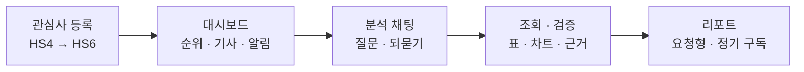
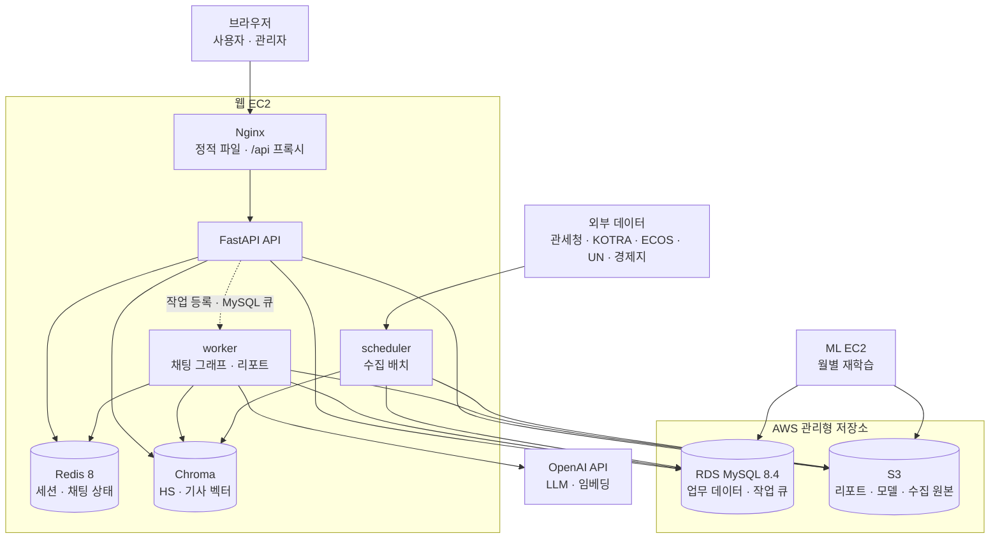
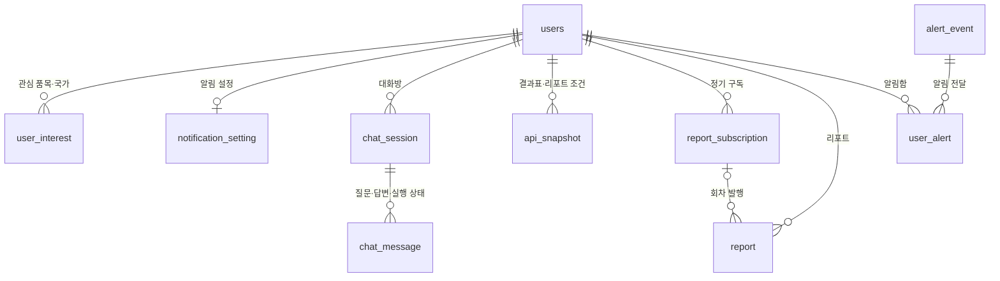
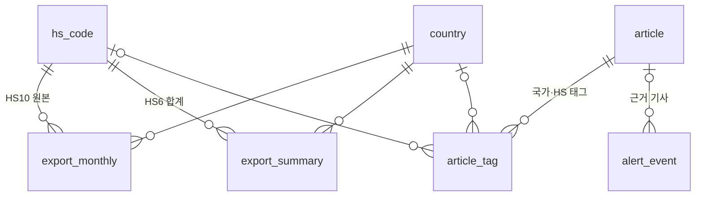
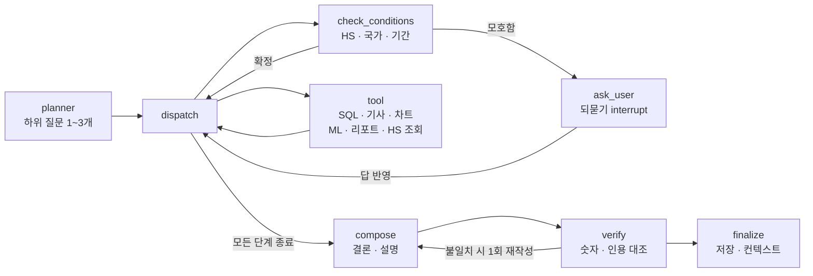
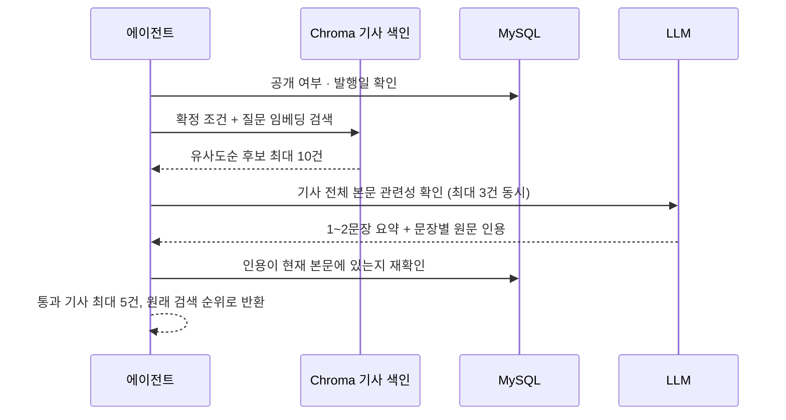
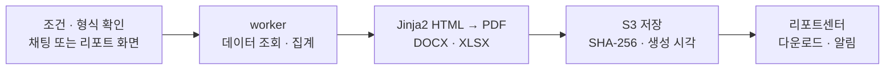

<div align="center">

# 🌐 Borderless Sellers

### 수출입 통계·해외 기사·유망시장 예측을 대화로 묻고, 근거가 있는 답변과 정기 리포트로 받는 무역통계 분석 에이전트

**질문하고 → 조건을 확인하고 → 데이터를 조회하고 → 검증된 답과 리포트를 받습니다.**

관세청 수출입 실적, KOTRA·경제지 기사, 환율, UN·BACI 시장 자료를 모아 두고, 중소 수출기업 담당자가 자연어로 질문하면 SQL 조회·기사 RAG·유망시장 모델 결과를 묶어 수치가 검증된 답변·표·차트·리포트로 돌려줍니다.

| 분야 | 기술 |
|:---:|---|
| **Frontend** |     |
| **Backend** |    |
| **AI / LLM** |     |
| **ML** |    |
| **DB / 상태** |   |
| **인프라 / CI·CD** |     |

**SK Networks Family AI Camp 33기 · 최종 프로젝트 · 3팀**<br/>
이수연 · 김혜진 · 이양원 · 허유나 · 윤지환

[서비스 화면](#experience) · [시스템 구조](#architecture) · [AI 평가 결과](#models) · [빠른 실행](#getting-started) · [설계 문서](#design-docs)

</div>

<!--
README 화면 캡처 안내 (GitHub 화면에는 보이지 않는 주석입니다)
- 화면 캡처 자리는 본문에 주석으로 남겨 두었습니다. 파일을 docs/assets/readme/ 에 넣고, 해당 주석 안의 이미지 줄을 주석 밖으로 꺼내면 됩니다.
- 캡처는 로컬 검증용 가상 데이터(python -m backend.scripts.local_integration seed)나 테스트 계정으로 촬영하고, 실제 회원 정보가 보이지 않게 합니다.
- 이미지를 넣으면 그 아래에 촬영 기준일과 데이터 출처를 한 줄로 적습니다.
- 캡처 목록: dashboard.png · analysis-answer.png · clarification.png · report-center.png · rank.png · admin.png
  · answer-evidence.png · system-architecture.png · erd-overview.png · report-pdf.png · ml-ndcg.png · actions.png
-->

## 목차

1. [Borderless Sellers 소개](#overview)
2. [Borderless Sellers 사용해 보기](#experience)
3. [기술 스택과 선정 이유](#tech-stack)
4. [시스템 아키텍처와 데이터 구조](#architecture)
5. [핵심 기능의 구현 과정](#pipelines)
6. [데이터와 AI 모델 검증](#models)
7. [결과의 근거 확인과 데이터 보호](#trust)
8. [실행 방법과 배포 환경](#getting-started)
9. [개발 성과와 개선 과제](#results)
10. [팀원과 프로젝트 문서](#team-docs)

---

<a id="overview"></a>
## 1. Borderless Sellers 소개

### 1.1 해결하려는 문제

수출 담당자가 "베트남 화장품 수출이 작년보다 늘었나?", "이 품목은 어느 나라가 유망하지?"를 확인하려면 관세청 통계 화면, HS 코드 검색, 해외 기사, 환율 자료를 따로 찾아 엑셀로 합쳐야 합니다. 일상에서 쓰는 품목명은 HS 코드와 바로 대응하지 않고, 판본(HS2017·HS2022)이 섞여 있어 숫자를 잘못 읽기도 쉽습니다.

Borderless Sellers는 이 과정을 **질문 → 조건 확정 → 조회 → 검증 → 답변·리포트**로 연결합니다. 과정 공통 주제인 **대화형 데이터 기반 분석 에이전트 및 자동 리포팅 플랫폼**을 무역통계 분석에 적용한 프로젝트입니다.

| 사용자에게 필요한 것 | Borderless Sellers의 접근 | 남기는 기록 |
|---|---|---|
| 품목·국가·기간을 정확히 정하기 | HS 사전 정확 일치 → 임베딩 후보 → 모호하면 되묻기 | 확정 조건, 적용한 기본값, 되묻기 이력 |
| 수치를 직접 계산하지 않고 확인하기 | 템플릿 SQL·검사된 LLM SQL로 조회, 답변 숫자를 결과표와 대조 | 결과표 스냅샷, 실행 SQL, 문장별 검증 결과 |
| 숫자 뒤의 배경 이해하기 | 기사 벡터 검색 + 본문 관련성 확인 + 문장별 원문 인용 | 기사 ID·출처·발행일, 인용 구절 |
| 다음에 어디로 수출할지 판단하기 | 유망시장 모델 A의 국가→품목·품목→국가 순위와 모델 B의 증감 예상 | 모델 버전, 기준월, 최근 12개월 수출액, 증가·감소 예상 |
| 정기적으로 시장을 확인하기 | 주간·월간·분기 구독 리포트와 요청형 리포트 | PDF·DOCX·XLSX 파일, 생성 조건, 생성 키 |

### 1.2 대상과 데이터 범위

- **사용자:** 중소 수출기업 실무자·창업자. 관심 품목(HS4·HS6)과 국가를 등록해 대시보드·알림·리포트를 받습니다.
- **관리자:** 회원·구독 월별 통계를 보고, 회원 권한·상태, 기사 노출·출처, 키워드 분류, 수집 기록, 감사 이력을 관리합니다.
- **질문 유형:** 수출입 추이·무역수지·기간 비교(비교 기간 여러 개 포함) · 순위 · 시장 점유율 · 변화 원인(통계+기사) · 현지 이슈 기사 · 유망시장 · 시장 유형(증감 예상) · HS 코드 조회 · 무역 용어·이전 대화 · 리포트 생성. 하나의 질문을 최대 3개의 하위 질문으로 나눠 처리합니다.
- **기준 데이터:** 관세청 HS10×국가×월 수출입 실적(2022-01~), KOTRA 해외시장뉴스·단신속보, 한국경제·파이낸셜뉴스 기사, 한국은행 ECOS 환율, UN Comtrade·CEPII BACI·World Bank WDI, HS2017·HS2022 코드 사전.

> **설계 원칙** — LLM은 숫자를 계산하지 않고 HS 코드를 만들지 않습니다. 합계·증감률·비중·순위는 SQL과 코드가 계산하고, 답변 문장의 숫자는 저장된 결과표와 다시 대조합니다. 유망시장 결과는 과거 실적 기반의 **상대 순위·증감 방향 예측**이며 실제 수출 성과를 보장하지 않습니다.

[에이전트 설계](docs/AGENT_DESIGN.md) · [ML 계획](docs/ML_PLAN.md)

### 1.3 확정 범위와 보류 범위

| 구분 | 내용 |
|---|---|
| **구현 완료** | 이메일 회원가입·로그인·계정 찾기(임시 비밀번호 메일), 관심사 등록, 메인 대시보드·수출입 순위·기사, LangGraph 분석 채팅(되묻기·표·차트·기사 근거·문장형 답변), 요청형·정기 리포트(PDF·DOCX·XLSX), 주요 이슈 알림, 관리자 화면, 유망시장 순위(모델 A)·증감 예상(모델 B) 조회 |
| **보류·제외** | 소셜 로그인(API 보류·화면 연결 제거), 회원 탈퇴(정책 보류), 5유형 시장 분류(과거 시장 라벨이 없어 미판정 → 시장 유형 질문은 모델 B 증감 예상으로 답변), 미진출 시장 발굴 모델 C(별도 계획), 기사 화면의 "AI에게 물어보기"(2026-11-11 사용 중지) |
| **운영 조건** | 관세청·UN 월간 수집은 매월 18일 03:00 KST, 운영 ML 재학습은 AWS 예약으로만 매월 19일 실행. 경제지·단신속보 일별 수집은 설정으로 켭니다 |

[백엔드 API 현황](docs/BACKEND_API_STATUS.md) · [미진출 시장 계획](docs/ML_NEW_MARKETS_PLAN.md)

<a id="experience"></a>
## 2. Borderless Sellers 사용해 보기

### 2.1 질문이 검증된 답변과 리포트로 이어지는 과정



| 단계 | 사용자가 하는 일 | 서비스가 제공하는 것 |
|:---:|---|---|
| 1 | 가입·약관 동의 후 관심 품목·국가 등록 | HS2022 4단위 검색 → 하위 HS6 목록 선택, 관심 국가 지정 |
| 2 | 메인 대시보드 확인 | 관심 범위의 수출입 추이·순위·점유율 카드, 관련 기사, 주요 이슈 알림 |
| 3 | 분석 채팅에 자연어로 질문 | 하위 질문 분해, 품목·국가·기간 확정, 모호하면 선택지(최대 5개)로 되묻기 |
| 4 | 답변 확인 | 결론·설명 문장, 결과표·차트, 기사 인용 카드, 대조하지 못한 문장의 "확인 필요" 표시 |
| 5 | 결과를 리포트로 저장 | 조건·형식 확인 → 생성 → 리포트센터에서 PDF·DOCX·XLSX 다운로드 |
| 6 | 정기 리포트 구독 | 주간(월요일)·월간(15일)·분기(1·4·7·10월 20일) 자동 발행 |

**주요 화면**

| 화면 | 확인할 수 있는 것 |
|---|---|
| 메인 대시보드 | 전체 시장·관심 시장 보기 전환, 수출입 KPI·추이·상위 품목, 한국의 세계시장 점유율(UN 자료), 환율, 관련 기사, 주요 이슈 |
| 분석 채팅 | 실행 계획·진행률, 되묻기 카드, 하위 질문별 결론·결과표·차트(비교 기간 여러 개를 한 표·그래프로)와 기사 인용 카드, 국가 비교 표, 리포트 저장·관심 추가 |
| 수출입 순위·기사 | 교역국·품목 순위(품목 여러 개 선택)와 엑셀 다운로드, 국가·품목·출처 조건의 기사 검색 |
| 리포트센터 | 생성 상태·유형·생성일 필터, 리포트 열람, 형식별 다운로드, 정기 구독 관리 |
| 마이페이지·알림함 | 관심사·알림 수신 설정, 주요 이슈·리포트 발행 알림, 미니 알림함(개별·전체 숨김) |
| 관리자 | 회원·구독 월별 통계, 회원 권한·상태, 기사 노출·출처, 키워드 분류 검수·대분류 관리, 수집 이력, 알림 전달 내역, 감사 이력 |

<!--
캡처 자리 (넣은 뒤 이미지 줄을 주석 밖으로 꺼내기)

**메인 대시보드: 관심 품목·국가의 수출입 현황** — 로그인 후 메인 대시보드. 관심 품목 카드·막대/도넛 차트·기사 카드가 함께 보이게.


**분석 채팅: 표·차트·근거가 붙은 답변** — 복합 질문(예: "작년과 올해 베트남 화장품 수출 비교하고 관련 기사도 알려줘")의 답변. 결론 문장·결과표·차트·기사 인용이 한 화면에 보이게.


**되묻기: 품목·국가가 모호할 때 선택지 제공** — "화장품"처럼 여러 HS6에 걸치는 품목을 물었을 때 후보 5개가 선택지로 나오는 화면.


<details>
<summary>리포트센터·수출입 순위·관리자 화면 보기</summary>


</details>
-->

[프론트엔드 안내](frontend/README.md) · [화면 목업 대응표](frontend/MOCKUP_MAP.md) · [연동 실행 안내](docs/INTEGRATION.md)

### 2.2 기록이 답변의 근거가 되는 예시

> **사용자 질문:** "작년 대비 올해 1~9월 미국 반도체 수출은 얼마나 늘었고, 이유가 뭐야?"

| 단계 | 에이전트가 하는 일 | 남는 기록 |
|---|---|---|
| 계획 | 질문을 **수치 비교**와 **원인 분석** 두 하위 질문으로 나눕니다 | 하위 질문·의도·단계 표 |
| 조건 확정 | "반도체"는 사전과 정확히 일치하지 않으므로 HS6 후보를 선택지로 되묻고, 고른 코드로 확정합니다. 기간은 올해 1~9월, 비교 기준은 전년 같은 기간입니다 | 확정 조건, 적용한 기본값, 되묻기 이력 |
| 조회 | 템플릿 SQL에 확정 값을 바인딩해 두 기간의 금액을 조회합니다 | 결과표 스냅샷, 실행 SQL |
| 기사 | 같은 국가·품목으로 통계 기간 앞뒤 1개월의 기사를 검색하고, 본문 관련성을 확인한 문장만 인용합니다 | 기사 ID·출처·발행일, 인용 구절 |
| 작성·검증 | 금액·증감률 문장을 결과표와 대조하고, 틀린 문장은 한 번 다시 씁니다. 그래도 다르면 "확인 필요"를 붙입니다 | 문장별 검증 결과, 재작성 횟수 |

기사는 원인으로 단정하지 않고, 통계와 기사 시점의 연관성만 설명합니다. 두 하위 질문이 같은 조회를 쓰면 한 번만 조회하고 결과를 함께 씁니다.

<!--
캡처 자리(선택): 위 예시 질문의 실제 답변 화면. 문장 끝의 근거 번호와 "확인 필요" 표시가 보이면 좋습니다.

-->

[answer JSON 형식](docs/AGENT_DESIGN.md#7-프론트에-주는-answer-json) · [기사 RAG](docs/rag/README.md)

<a id="tech-stack"></a>
## 3. 기술 스택과 선정 이유

| 영역 | 사용 기술 | 역할·선정 이유 |
|---|---|---|
| **Web** | React 19, Vite 8, JSX, oxlint | 대시보드·분석·리포트·관리자 화면. 화면설계서 목업을 유지하고 API를 연결 |
| **업무 API** | Python 3.11, FastAPI, Pydantic, SQLAlchemy 2.0, PyMySQL, bcrypt | 계정·관심사·통계·채팅·리포트·관리자 API(`/api/v1`). 모델 runtime(scipy 1.10.1)과 맞추려고 3.11 고정 |
| **작업 실행기** | MySQL 기반 job claim·lease(10분) worker | 채팅 그래프·리포트 생성을 API와 분리. 작업마다 스레드로 병렬 처리하고, 워커가 죽으면 다른 워커가 이어서 실행 |
| **AI 에이전트** | LangGraph 1.2, langgraph-checkpoint-redis | 플래너 → 조건 확인 → tool → compose → verify 분기, 되묻기 interrupt·재개, 실행 state 체크포인트 |
| **LLM** | OpenAI API — 플래너 `gpt-5.6-luna`, 직접 입력 해석·Writer·SQL 생성·기사 요약 `gpt-6-luna` | 구조화 출력(Pydantic 스키마). 역할별 환경 변수로 교체. 플래너·Writer는 노드별 모델 비교 평가로 선정 |
| **SQL 안전성** | sqlglot | LLM이 만든 SQL을 파싱해 SELECT·허용 테이블·확정 조건 범위·LIMIT를 검사한 뒤 READ ONLY 트랜잭션으로 실행 |
| **벡터 검색** | Chroma, `text-embedding-3-large`(3,072차원) | HS 품목명(상위 분류 경로 포함) 컬렉션, 기사 본문 색인 |
| **유망시장 ML** | LightGBM(Regressor·Ranker), scikit-learn, pandas | 다음 12개월 수출 성장 순위(모델 A)와 증감 방향(모델 B) |
| **수집 스케줄러** | APScheduler, requests, openpyxl | 관세청·UN 월간, ECOS 환율·HS 임베딩·기사 일간, 외부 자료 월간, HS 사전 연간 |
| **리포트** | Jinja2 + Playwright Chromium(HTML→PDF), python-docx, openpyxl, matplotlib | 요청형·정기 리포트를 PDF·DOCX·XLSX로 생성 |
| **DB·파일** | MySQL 8.4(AWS RDS), S3 | 업무 데이터는 MySQL, 리포트·모델·수집 원본은 S3(`ARTIFACT_STORAGE=s3`) |
| **세션·상태** | Redis 8.2(AOF, noeviction) | 로그인 세션·CSRF·요청 제한, 채팅 컨텍스트·대화방 lock·그래프 체크포인트 |
| **배포** | AWS EC2(웹·ML), Nginx, GitHub Actions OIDC, S3 배포 수신기(systemd timer) | 검사 통과 커밋만 S3로 전달 → EC2 수신기가 검사·적용·결과 보고 |
| **테스트** | unittest, pytest, fakeredis, node:test, Playwright | 외부 연결 없는 단위 테스트, 로컬 Docker 연동 테스트, 브라우저 회귀 |

버전은 [Web 의존성](frontend/package.json), [API·worker 의존성](backend/requirements-api.txt), [수집·ML 의존성](backend/requirements.txt)을 기준으로 정리했습니다. 역할별 LLM 기본값은 [API 설정 예시](backend/.env.api.example)와 [에이전트 설계 §13.3](docs/AGENT_DESIGN.md#133-환경변수)에 있습니다.

<a id="architecture"></a>
## 4. 시스템 아키텍처와 데이터 구조

**디렉터리 구조**

```text
SKN33-Final-3Team/
├── frontend/                   # React 웹 (사용자·관리자 화면)
│   ├── src/
│   │   ├── pages/              # auth · home · market · analysis · account · terms
│   │   ├── admin/              # 관리자 화면
│   │   ├── components/         # 차트·기사 카드·알림 팝업 등 공통 부품
│   │   └── api/                # 백엔드 API 호출 (HttpOnly 쿠키·CSRF·요청 ID)
│   └── tests/                  # node:test 단위 테스트, Playwright 브라우저 회귀
├── backend/
│   ├── app/
│   │   ├── api/                # FastAPI 라우트·채팅 접수·작업 실행기·리포트·보안
│   │   ├── agents/             # LangGraph 에이전트 (planner·conditions·sql·compose·verify …)
│   │   ├── ml/                 # 유망시장 모델 A(2단계 LightGBM)·모델 B(증감 예상)·피처·검증
│   │   ├── scheduler/          # APScheduler 수집 배치
│   │   │   ├── collectors/     # 관세청·KOTRA 뉴스·단신·경제지·HS 코드·ECOS·UN·외부 자료
│   │   │   └── jobs/           # 수집 → 검증 → 적재 → 색인·알림
│   │   ├── services/           # 기사 RAG·키워드 분류·리포트 템플릿 등 공용 로직
│   │   ├── storage/            # 로컬·S3 저장소 전환
│   │   ├── db/ · models/ · schemas/
│   │   └── templates/reports/  # 리포트 Jinja2 템플릿 (HTML → PDF)
│   ├── evals/agent/            # 에이전트 노드 평가 실행기
│   ├── migrations/             # API 연동 단계 마이그레이션 SQL
│   ├── scripts/                # 로컬 연동·마이그레이션·평가 실행기
│   └── tests/                  # 백엔드 테스트
├── db/mysql/                   # 초기 테이블·시드 SQL(init/)과 마이그레이션
├── deploy/                     # CI 테스트 러너·AWS 배포 수신기·Redis·단신 worker 설정
├── data/un_data/               # UN 수집 범위·기준 파일 (원본·모델 파일은 Git 제외)
├── notebooks/                  # 모델 A 실험·검증 보고서 노트북
├── output/agent_eval/          # 에이전트 노드별 모델 비교 결과
├── docs/                       # 설계·평가·운영 문서
├── .github/workflows/          # 테스트·AWS 배포
└── compose.integration.yml     # 로컬 MySQL·Redis
```

### 4.1 시스템 아키텍처

AWS 배포 구성의 요약입니다. 웹 EC2 한 대에 Nginx·API·worker·scheduler·Redis·Chroma가 함께 있고, 업무 데이터는 RDS, 파일은 S3에 둡니다. 월별 재학습은 별도 ML EC2가 맡습니다.



<!--
캡처 자리: 발표 자료의 AWS 배포 구성도를 PNG로 내보내 넣기.
[](docs/assets/readme/system-architecture.png)
-->

### 4.2 구성 요소의 책임

API 서버는 질문을 접수하고 작업을 등록만 합니다. 오래 걸리는 그래프 실행과 리포트 생성은 worker가 맡고, 화면은 2초마다 작업 상태를 조회해 진행 단계를 표시합니다. 검증을 마친 최종 답변만 SSE로 전송합니다.

| 구성 요소 | 담당 업무 | 저장소 |
|---|---|---|
| **Nginx** | 웹 정적 파일 제공, `/api` 요청을 FastAPI로 전달 | — |
| **API 서버** | 인증·관심사·통계 조회, 채팅 접수·되묻기 답·중단, 리포트 요청·다운로드, 관리자 | MySQL, Redis, S3 |
| **worker** | 채팅 그래프 실행·재개, 리포트 생성, 정기 리포트 발행 검사. 작업마다 스레드로 병렬 처리 | MySQL, Redis 체크포인트, Chroma, S3 |
| **에이전트 그래프** | 하위 질문 분해, 조건 확정, SQL·기사·차트·ML·리포트·HS 조회 tool, 답변 작성·검증 | state에는 ID와 요약만, 원본은 MySQL |
| **scheduler** | 관세청·UN 월간, ECOS 환율·HS 임베딩·기사 일간, 주요 이슈 판정(05:00·08:00), 외부 자료 월간, HS 사전 연간 갱신 | MySQL `batch_run`, Chroma, S3 |
| **ML EC2** | 월별 피처 생성, 모델 A·B 재학습, 레지스트리 등록 | S3 `models/`, MySQL `ml_model_version` |

전체 실행 흐름과 장애 처리는 [에이전트 설계 §3](docs/AGENT_DESIGN.md#3-실행-흐름), Redis 키 규칙은 [§6](docs/AGENT_DESIGN.md#6-redis-임시)을 따릅니다.

### 4.3 핵심 테이블 관계

**회원·대화·리포트·알림** — 질문·답변과 작업 실행 상태는 `chat_message`에, 조회 결과표와 리포트 조건 확인은 `api_snapshot`에 남깁니다.



**무역 실적·기사** — 실적·기사 태그·관심사는 모두 같은 HS 사전(`hs_code`, 판본 포함)과 국가 표(`country`)를 참조합니다. 수출 실적은 HS10 원본(`export_monthly`)과 HS6 합계(`export_summary`)로 나뉘며, 수입도 같은 구조입니다.



그 밖에 수입 실적(`import_monthly`·`import_summary`), 환율(`fx_daily`), UN 자료(`un_data`), 판본 대응표(`hs_code_correlation`), 키워드 분류(`keyword_topic`·`article_classification`), 약관 동의(`user_consent`), 수집 실행 기록(`batch_run`), 관리자 감사 이력(`api_audit_event`), 모델 등록(`ml_model_version`)이 있습니다. 테이블 정의는 [db/mysql/init](db/mysql/init), 연동 단계에서 추가한 컬럼·테이블은 [연동 실행 안내](docs/INTEGRATION.md#확정-저장소)를 기준으로 합니다.

<!--
캡처 자리: DB 설계서의 전체 ERD를 PNG로 내보내 넣기.
[](docs/assets/readme/erd-overview.png)
-->

<a id="design-docs"></a>
### 4.4 설계 문서 안내

| 문서 | 확인할 내용 |
|---|---|
| [에이전트 설계](docs/AGENT_DESIGN.md) | 결정 사항(D-xx), state 규칙, 실행 흐름, tool별 파이프라인, 미정 사항(C-xx) |
| [채팅 API 변경](docs/AGENT_API_CHANGES.md) | 채팅·작업 상태·되묻기·중단 API 계약 |
| [백엔드 실행·인계](docs/BACKEND_API.md) · [API 현황](docs/BACKEND_API_STATUS.md) | 엔드포인트 목록, 기능별 변경 이력과 검증 |
| [관리자 월별 집계](docs/ADMIN_METRICS.md) · [관리자 대분류 API](docs/ADMIN_KEYWORD_API.md) | 회원·구독 월별 집계 기준, 대분류 이름 수정·삭제 계약과 동시 수정 잠금 |
| [연동 실행 안내](docs/INTEGRATION.md) | 로컬 MySQL·Redis, 세션·요청 제한, 정기 리포트 발행 규칙 |
| [S3 저장소 전환](docs/S3_STORAGE.md) | 파일·모델·실행 상태의 S3 저장과 이관 절차 |
| [ML 계획](docs/ML_PLAN.md) · [ML 실험](docs/ML_A_EXPERIMENTS.md) · [ML 사용](backend/app/ml/ML_USAGE.md) | 유망시장 문제 정의, 피처·평가 설계, 모델 B, 운영 재학습 |
| [기사 RAG](docs/rag/README.md) | 기사 검색·본문 관련성·인용 검수 순서와 시간 예산 |
| [에이전트 평가 계획](docs/AGENT_EVAL.md) · [노드별 모델 비교](output/agent_eval/SUMMARY_20261109.md) | 평가 지표·세트 구성, 플래너·조건 확인·문장형 답변·컨텍스트 모델 비교 |
| [배포](deploy/ci/README.md) · [서버 반영 절차](docs/DEPLOY_FEAT52.md) | GitHub Actions 검사, AWS OIDC·S3 수신기 배포, 모델 파일·`.env`·마이그레이션 반영 순서 |

<a id="pipelines"></a>
## 5. 핵심 기능의 구현 과정

### 5.1 질문 → 조건 확정 → 조회 → 검증된 답변



1. API 서버가 질문(4,000자 이하)을 받아 이메일·전화번호를 마스킹하고, 같은 대화방에 실행 중인 작업이 있으면 409로 막습니다. 멱등키로 중복 접수를 막고, 질문과 입력 스냅샷을 MySQL에 저장한 뒤 작업을 등록합니다.
2. **planner**가 LLM 1회로 질문을 하위 질문 1~3개로 나누고, 의도와 슬롯(품목·국가·기간·비교)을 뽑아 단계 표를 만듭니다.
3. **check_conditions**가 품목을 HS 사전과 정확히 일치할 때만 확정하고, 그 밖은 임베딩 상위 5개 HS6 후보로 되묻습니다. 빈 조건은 최근 조건 → (대화방 첫 질문이면) 관심사 → 기본값 순서로 채우고, 적용한 기본값을 답변에 남깁니다. 같은 조건은 최대 2회까지만 묻고, 되묻기는 30분 동안 기다립니다. HS2017 품목은 추이·단순 금액 순위에서 판본별로 조회하고, 기사로 설명하는 원인·현지 이슈는 판본 대응표로 HS2022 품목에 확정합니다.
4. **tool**이 실행됩니다. 추이(무역수지 포함)·순위·점유율은 서버가 정한 템플릿 SQL에 값을 바인딩하고, 템플릿에 없는 질문은 LLM이 만든 SQL을 sqlglot으로 검사한 뒤 READ ONLY 트랜잭션으로 실행합니다(실패하면 직전 오류를 주고 최대 2회 재생성). 생성 SQL은 수출·수입 원본 표끼리 바로 조인하지 못하게 해 금액 중복 합산을 막습니다.
5. **compose**가 결과가 있는 하위 질문만 LLM 1회로 결론·설명 문장을 씁니다. 숫자는 코드가 만든 결과 요약(digest)의 값만 옮깁니다. 이전 대화를 이어 설명하는 문장형 답변은 `compose_text`가 같은 규칙으로 씁니다.
6. **verify**가 문장마다 수치·증감 주장(한글로 쓴 금액·퍼센트, 무역수지 흑자·적자 부호 포함)을 저장된 결과표와 대조합니다. 틀리면 한 번 다시 쓰고, 여전히 다르면 해당 문장에 "확인 필요"를 붙입니다. 생성 SQL이 조회 기간 전체를 집계했다고 증명하지 못한 수치는 문장에 쓰지 않고 결과표 안내로 바꿉니다.
7. **finalize**가 answer JSON·결과표·검색 조건을 저장하고, 검증된 요약만 다음 대화의 컨텍스트로 넘깁니다.

실행 예산은 한 라운드(접수 또는 되묻기 답 이후) 180초 누적이며, 노드마다 실행 시간을 미리 예약하고 중단 여부를 확인합니다. 워커가 죽으면 lease 10분 뒤 다른 워커가 체크포인트에서 이어서 실행합니다(최대 2회).

[실행 흐름](docs/AGENT_DESIGN.md#3-실행-흐름) · [플래너 단계 표](docs/AGENT_DESIGN.md#51-플래너-단계-표-하위-질문-하나-기준-step_id-앞에-t1-같은-접두사를-붙인다) · [숫자 대조](docs/AGENT_DESIGN.md#114-숫자-대조-agentsverifypy) · [노드별 실행 시간](docs/AGENT_DESIGN.md#134-노드별-최대-실행-시간-실행-예산-예약-d-85)

### 5.2 기사 RAG → 문장별 원문 인용



- 공개 여부와 발행일 조건은 후보를 고르기 전에 적용하고, 국가·품목 태그를 강제 필터로 쓰지 않습니다. 기사 본문이 질문 대상을 설명하는지로 판단합니다.
- 사용자 키워드 차단은 기사 목록·알림·리포트에 적용되며, 채팅 기사 검색에는 아직 적용하지 않습니다(후속 과제).
- 질문의 일부만 기사로 확인되면 확인된 부분만 답하고, 확인하지 못한 구절을 `unverified_question_parts`로 남깁니다.
- 요청당 30초(최신순 15초) 예산 안에서 검수를 마친 기사만 반환합니다.
- 기사 본문은 `text-embedding-3-large`로 1,000자·150자 겹침 조각으로 색인합니다(약 12.8만 조각). 워커는 시작할 때 색인을 미리 열고, 프로세스 안에서 같은 세대의 색인 핸들을 재사용합니다.

[기사 RAG](docs/rag/README.md) · [색인 이관](docs/NEWS_INDEX_MIGRATION.md)

### 5.3 요청형·정기 리포트 생성



- **요청형:** 사용자가 고른 품목·국가·기간·비교·섹션으로 만듭니다. 채팅에서는 조건과 형식을 확인받은 뒤 생성하고, 완료될 때까지 채팅 작업이 기다립니다. 직전 답변의 결과표를 그대로 리포트로 남길 수도 있습니다.
- **정기 구독:** 주간은 매주 월요일에 직전 주, 월간은 매월 15일에 전월, 분기는 1·4·7·10월 20일에 직전 분기 자료를 발행합니다. 해당 기간의 수집 배치가 모두 SUCCESS여야 발행하며, 데이터가 늦으면 준비될 때까지 기다립니다.
- 같은 구독·주기·기간은 생성 키로 중복 발행을 막고, 워커가 꺼졌다 켜지면 지난 미발행 회차를 확인해 발행합니다.
- XLSX 머리글에는 열 단위를 붙이고, 값이 없는 칸을 0으로 채우지 않습니다. PDF·DOCX의 금액·비율은 소수 둘째 자리까지 씁니다.

<!--
캡처 자리: 생성된 리포트 PDF의 첫 장(요약·차트가 보이는 페이지).

-->

[정기 리포트 구독과 자동 발행](docs/INTEGRATION.md#정기-리포트-구독과-자동-발행) · [리포트 템플릿](backend/app/templates/reports/README.md)

### 5.4 데이터 수집과 적재

| 데이터 | 주기 (KST) | 처리 |
|---|---|---|
| 관세청 수출입 실적 (HS10×국가×월) | 매월 18일 03:00 | 전월 수집 → 검증 → HS10 원본·HS6 합계 적재 → 지표 계산, 누락·실패 월 자동 복구 |
| UN Comtrade 품목 자료 | 매월 18일 03:00 | 변경분 갱신, 중단되면 1분 간격으로 재개 여부 확인 |
| 외부 시장 자료 (BACI·WDI·Comtrade) | 매월 1일 04:00 | ML 피처 입력용 CSV 갱신 |
| 한국은행 ECOS 환율 | 매일 06:00 | 전 영업일 환율까지 적재, 빠진 날은 마지막 적재일부터 채움 |
| 경제지 기사 (한국경제·파이낸셜뉴스) | 매일 03:00 (`NEWS_DAILY_ENABLED`) | 전날 기사 수집·검수 → 기사·태그·일별 집계 적재 → 기사 벡터 색인 |
| KOTRA 단신속보 | 매일 03:00 (선택 운영) | 전날 전체 페이지 수집 → 적재, 실패·중단 날짜 재처리 |
| KOTRA 해외시장뉴스 | 수동 적재 | 키워드 분류·국가·HS 태깅 |
| HS 품목명 임베딩 | 매일 01:00 | Chroma에 없는 신규 코드만 임베딩 |
| HS 코드 사전 | 매년 1월 1일 00:15 | HS2017·HS2022 판본·대응표 갱신, 새 판이 없으면 다음 날 재시도 |
| 주요 이슈 판정 | 매일 05:00·08:00 | 기사량 급증(최근 7일 ÷ 직전 8주 주평균 3배 이상)·통상·규제 기사를 알림함에 전달 |

수집기는 호출과 파싱만 담당하고, 적재·실행 기록(`batch_run`)은 `jobs/`가 맡습니다. 리포트 발행·주요 이슈 판정은 이 실행 기록의 SUCCESS를 확인한 뒤 진행하며, 수집이 끝나지 않은 날을 0건으로 보지 않습니다.

### 5.5 계정·보안·관리자 운영

| 영역 | 처리 흐름 |
|---|---|
| 로그인 세션 | 무작위 토큰을 HttpOnly 쿠키로 발급 → Redis에 토큰 해시·회원 번호·CSRF 해시 저장 → 12시간 만료 |
| 세션 무효화 | 비밀번호·권한·상태 변경 시 `auth_version`을 올려 모든 기기의 세션 무효화 |
| 요청 제한 | 로그인·가입·HS 검색 횟수를 Lua로 원자적으로 증가. 초과 429, Redis 장애 503(제한 우회 없음) |
| 계정 찾기 | 이름·이메일 일치 확인 → DB 저장 후 임시 비밀번호 메일 발송. 이메일당 10분 1회·24시간 5회 제한 |
| 관리자 | USER/ADMIN 두 역할. 다른 ACTIVE 회원 권한 변경 시 사유·확인·버전 검사, 자기 계정 변경 금지, 감사 이력 기록 |
| 키워드 관리 | 관리자 분야 사전·대표어 관리와 검수, 대분류 추가·이름 수정·삭제(동시 수정은 MySQL 이름 잠금으로 막음), 사용자별 키워드 차단 저장 |

[Redis 세션과 요청 제한](docs/INTEGRATION.md#redis-입문)

<a id="models"></a>
## 6. 데이터와 AI 모델 검증

### 6.1 데이터와 역할 분담

| 데이터·모델 | 용도 | 처리·검증 기준 |
|---|---|---|
| **관세청 수출입 실적** | 통계 조회·리포트·ML 정답 | 2022-01~2026-09(57개월) 원본 7,702,770행. 총계 행 1,218개 제외, 연간 합계를 공식 통계와 대조 |
| **HS 코드 사전** | 품목 확정·검색 | HS2017·HS2022 18,948 코드, 대응 15,657쌍. 검색·기능에는 4·6단위만 사용 |
| **KOTRA·경제지 기사** | 기사 RAG·주요 이슈 판정 | 단신속보 18,607건(66개국, 2022-08~2026-10) 등. 본문 관련성·인용 검수 |
| **UN·BACI·WDI·환율** | 유망시장 모델 피처 | 사용 가능 시점을 기록하고, 과거 시점 값을 확보하지 못한 피처는 보수적으로 제외 |
| **자체 평가 세트** | SQL·리포트 플래너·Writer 평가 | 합성 DB(`synthetic-trade-v1`)·합성 입력. AI가 작성한 정답이며 사람 검토 대기 |

수치는 2026-10-22 EDA 기준입니다. 원본·가공 데이터, 피처 캐시, 모델 파일은 Git에 넣지 않습니다. [ML 계획 §3](docs/ML_PLAN.md#3-수집-데이터-현황-2026-10-22-eda)

### 6.2 유망시장 모델 입력·출력

| 구분 | 모델 A — 유망도 순위 | 모델 B — 증감 예상 |
|---|---|---|
| 문제 정의 | (국가, HS6, 기준월)마다 **다음 12개월 한국 수출 성장 순위**를 예측. 최근 12개월 수출 $100K 이상인 기존 수출 쌍이 대상 | 같은 쌍의 다음 12개월 수출이 늘지 줄지 방향을 예측 |
| 구조 | 1단계 `LGBMRegressor`(로그 성장값) → 2단계 `LGBMRanker`(국가별 1단계 상위 100개 재정렬) + 품목 방향 순위 모델 | LightGBM Huber 회귀. 예측 성장률 0% 이상이면 "증가 예상", 아니면 "감소 예상" |
| 앙상블 | 외부 피처 없는 v1(33개)과 외부 피처 포함 v3(42개)의 순위 평균 | v1·v3 예측 평균 |
| 서비스 표시 | 국가 → 유망 품목 순위, 품목 → 유망 국가 순위, 최근 12개월 수출액 | 순위 표의 "증감 예상" 열, 시장 유형 질문("증가 예상 시장"·"감소 예상 시장") |
| 운영 버전 | `model_a_two_stage_202609` (학습 기준월 2023-12~2025-09, 1,079,108행 · 예측 49,083쌍) | `model_b_growth_<YYYYMM>` (모델 A와 같은 기준월일 때만 표시) |

채팅 `query_market_model` tool과 리포트의 유망시장 섹션이 S3 월별 레지스트리에서 최신 READY 모델을 읽습니다. 모델 A의 예측 증감률은 평균 쪽으로 몰리는 경향이 있어(예측 중앙값 −16.8%, 실제 −8.1%) 순위 계산에만 쓰고 답변에는 넣지 않습니다. 화면에 보이는 방향은 모델 B의 결과입니다.

### 6.3 모델 평가 결과와 해석

모델 A는 평가 기준월 2025-09, 미래 정답 2025-10~2026-09, 학습 마지막 기준월과 12개월 간격을 둔 시간 분할로 평가했습니다. 기준선은 **직전 12개월 성장 순위**입니다.

| 지표 | 기준선 | 모델 A |
|---|---:|---:|
| **국가별 품목 추천 NDCG@5** (채택 지표) | 0.346 | **0.725** |
| 품목별 국가 추천 NDCG@5 | 0.451 | 0.691 |
| 국가별 Hit@5 | — | 0.483 |
| 시간 순서 3-fold 국가별 NDCG@5 평균 (1차 모델) | 0.332 | 0.717 (표준편차 0.011) |

| 모델 B 지표 | 모두 감소로 답할 때 | 모델 B |
|---|---:|---:|
| 증감 방향 정답률 (2026-09 월별 학습 Holdout) | 56.6% | **60.7%** |
| 2025-08 사후 Holdout, 개선 전 → 후 | 55.6% | 59.29% → 60.66% |

- 품목별 NDCG@5는 품목 방향 순위 모델을 더한 앙상블 기준입니다([ML 사용 안내](backend/app/ml/ML_USAGE.md#최종-모델-생성조회)).
- 반도체(HS4 8541·8542)는 기준선 대비 개선 폭이 작아(1차 모델 0.659 vs 0.608) 품목군별로 따로 보고합니다.
- fold 사이 미래 정답 창이 겹치므로 평균·표준편차는 기술 통계이며 신뢰구간이 아닙니다.
- 모델 B의 성장률 숫자는 오차가 커서(2025-08 MAE 약 73%p) 화면에는 방향만 표시합니다.

<!--
캡처 자리(선택): ML 검증 리포트 PDF(output/pdf/)의 NDCG 비교 차트 또는 fold별 표.

-->

[모델 A 실데이터 검증](docs/ML_VALIDATION_20261022.md) · [ML 실험](docs/ML_A_EXPERIMENTS.md) · [모델 B 증감 예상](backend/app/ml/ML_USAGE.md#증감-예상-모델모델-b)

### 6.4 에이전트 평가 결과

모든 평가는 실제 LLM을 호출하고, 실패를 보고 고친 **개발 세트(Dev)** 와 고정 후 한 번만 실행한 **Holdout**을 구분합니다. 정답은 AI가 작성했으며 사람 검토는 대기 중입니다.

| 평가 | 세트 | 결과 | 평가 당시 모델 |
|---|---|---|---|
| **SQL Agent** (Text-to-SQL) | Holdout 30문항 | 정상 조회 결과 일치 **18/20 (90%)**, 실행 성공 20/20, 올바른 거부 10/10, 차트 유형 29/30 | `gpt-4.1` |
| SQL Agent | Dev 40문항 (개선 전 → 후) | 결과 일치 14/32 → 32/32, 재생성 38 → 3회, 금지 SQL 실행 0건 | `gpt-4.1` |
| **리포트 플래너** | Holdout 24문항 | **21/24 (87.5%)**. 의도·리포트 여부·수출입·국가·품목 100%, 선행 연결 89.5% | `gpt-4.1-mini` |
| **노드별 모델 비교** (플래너) | Holdout 28문항 | `gpt-5.6-luna` **92.9%**·파싱 실패 0% (`gpt-6-luna` 82.1%, `gpt-4.1-mini` 60.7%) | 3개 모델 비교 |
| **Writer (Compose)** | 독립 Holdout 100문항 | **91/100**, 신규 67문항 61/67. 후보 `gpt-5.6-luna` 90/100 | `gpt-6-luna` |

- SQL Holdout 실패 2건은 건수 단위 누락과 요청하지 않은 열 추가이며, 금액·중량 계산 오류는 아닙니다.
- 리포트 플래너는 **결과 기반 리포트 연결**(이전 결과를 리포트로 남기기)과 "최근 1년" 같은 상대 기간 환산이 약점으로 나타났습니다.
- 플래너는 Holdout 통과율이 가장 높고 파싱 실패가 없는 `gpt-5.6-luna`로, Writer는 응답 시간 중앙값이 약 38% 짧고 비용이 약 66% 낮은 `gpt-6-luna`로 정했습니다(2026-11-10).
- SQL·리포트 플래너 결과는 평가 당시 모델 기준입니다. 현재 기본값(SQL `gpt-6-luna`, 플래너 `gpt-5.6-luna`)으로 같은 세트를 다시 측정하는 일이 남아 있습니다.
- 합성 데이터·소규모 단일 실행이므로 서비스 전체의 일반 정확도로 확대 해석하지 않습니다.

[SQL 실제 호출](docs/SQL_LIVE_EVALUATION.md) · [SQL Holdout](docs/SQL_HOLDOUT_EVALUATION.md) · [리포트 플래너 Holdout](docs/REPORT_AGENT_HOLDOUT_EVALUATION.md) · [노드별 모델 비교](output/agent_eval/SUMMARY_20261109.md) · [Writer Holdout](docs/evaluations/WRITER_HOLDOUT_EVALUATION.md)

### 6.5 구현과 활성화 상태

| 기능 | 현재 상태 | 적용 조건 |
|---|---|---|
| LangGraph 채팅 에이전트 | 구현·배포 | `API_CHAT_AGENT_ENABLED=true`, Redis 8(RedisJSON·RediSearch). 끄면 기존 `chat.execute` 경로 |
| HS 벡터 검색 | 구현, 설정 시 활성 | `API_HS_VECTOR_ENABLED=true`, `OPENAI_API_KEY`, Chroma 경로. 없으면 DB 사전 검색만 사용 |
| 유망시장 모델 A | 운영 모델 등록·조회 | S3 월별 레지스트리의 READY 모델, Python 3.11·LightGBM runtime 일치 |
| 증감 예상 모델 B | 구현·연결 | 모델 A와 같은 기준월 파일이 있을 때만 방향 표시. 없으면 방향 없이 답하고 안내 |
| 5유형 시장 분류 | **미판정** | 공개된 과거 시장 라벨·임계값 확보 후 재검증 |
| 경제지·단신속보 일별 수집 | 구현, 설정 시 활성 | `NEWS_DAILY_ENABLED=true`, `SHORTNEWS_DAILY_ENABLED=true` 또는 단신 전용 worker |
| 운영 ML 재학습 | AWS에서만 예약 | 수집 다음 날(매월 19일). 통합 수집 스케줄러는 학습하지 않음 |

<a id="trust"></a>
## 7. 결과의 근거 확인과 데이터 보호

### 7.1 어떤 기록으로 설명했는지 확인합니다

| 확인 지점 | 구현 방식 | 해석 범위 |
|---|---|---|
| 답변의 숫자 | 문장별 수치·증감 주장을 저장된 결과표 스냅샷과 대조, 1회 재작성 | 불일치가 남으면 "확인 필요" 표시, 다음 대화 요약에서 제외 |
| LLM SQL | sqlglot로 SELECT·허용 테이블·확정 조건 범위·LIMIT 1,000을 검사한 뒤 READ ONLY 트랜잭션·쿼리당 30초 상한으로 실행 | 검사 실패 SQL은 실행하지 않고 최대 2회 재생성. 개인정보·시스템 테이블과 기사 본문 열은 조회 불가. 조회 기간 전체를 집계했다고 증명되지 않은 수치는 답변 문장에서 빼고 결과표 안내로 대체 |
| 품목 코드 | HS 사전 정확 일치만 확정, 나머지는 후보 제시 후 사용자 선택 | LLM이 HS 코드를 만들지 않음 |
| 기사 인용 | 반환 인용이 현재 DB 본문에 있는지 재확인, 출처·기사 ID·발행일 대조 | 숨겨지거나 본문이 바뀐 기사는 내용을 가림. 질문 전체에 답했다는 보장은 하지 않음 |
| 결측값 | 수집되지 않은 값·서버가 제공하지 않는 지표는 만들지 않음 | 0과 빈 값을 섞지 않고, 503을 가짜 숫자나 빈 성공값으로 대체하지 않음 |
| 리포트 발행 | 해당 기간 수집 배치 SUCCESS 확인 후 발행 | 데이터 지연 시 실제 생성일이 늦어질 수 있음 |

### 7.2 계정과 데이터를 보호합니다

- **비밀번호·세션:** 비밀번호는 bcrypt 해시로만 저장하고 Redis에는 넣지 않습니다. 세션 토큰은 해시로 저장하며, 프론트는 계정·비밀번호·서비스 결과를 localStorage에 저장하지 않습니다.
- **개인정보 가림:** 채팅 질문 속 이메일·전화번호를 마스킹한 뒤 처리합니다. 기사는 적재할 때 작성자·기고자 정보를 지우고, 답변 작성(Writer) 입력에는 기사 본문 대신 검수된 요약·인용만 넣습니다.
- **DB 권한:** LLM SQL은 READ ONLY 트랜잭션에서 허용 목록의 테이블만 조회합니다. DDL은 앱 시작 시 자동 실행하지 않고, 마이그레이션은 계획 기록 → 명시적 적용 → 백업 순서로 진행합니다.
- **비밀 값:** Redis 비밀번호는 Git에 올리지 않는 secret 파일로 전달하고, 배포는 장기 키 없이 GitHub OIDC 역할로 S3에 접근합니다.
- **약관·동의:** 서비스 이용약관·개인정보 수집·알림 수신 동의를 분리해 관리합니다. [약관 문서](docs/terms/README.md)

<a id="getting-started"></a>
## 8. 실행 방법과 배포 환경

### 8.1 빠른 실행

**필수 환경:** Git, Docker Desktop, Python 3.11, Node.js 20.19 이상 또는 22.12 이상. Linux에서 ML 포함 백엔드를 설치할 때는 [Linux 배포 준비](backend/app/ml/ML_USAGE.md#linux-배포-준비)(LightGBM OpenMP 런타임)를 먼저 확인합니다.

```powershell
git clone https://github.com/20260528-skn-family-ai-33/SKN33-Final-3Team.git
cd SKN33-Final-3Team
docker compose -f compose.integration.yml up -d --wait
python -m venv .venv
.\.venv\Scripts\Activate.ps1          # macOS·Linux: source .venv/bin/activate
python -m pip install -r backend/requirements-api-test.txt
python -m playwright install chromium
```

처음 빈 DB에서만 schema를 실행하고, 이후에는 migrate만 실행합니다. seed는 미국·중국·화장품 등 **가상 검증 데이터**를 로컬에 만들며 RDS 데이터를 복사하지 않습니다.

```powershell
python -m backend.scripts.local_integration schema
python -m backend.scripts.local_integration migrate
python -m backend.scripts.local_integration seed
python -m backend.scripts.local_integration check
```

세 터미널에서 API·worker·웹을 실행합니다. Python 터미널마다 가상환경을 활성화합니다.

```powershell
# 터미널 1: API
python -m backend.scripts.local_integration api
# 터미널 2: worker
python -m backend.scripts.local_integration worker
# 터미널 3: 웹
cd frontend
npm ci
npm run dev -- --host 127.0.0.1
```

| 대상 | 기본 주소 | 용도 |
|---|---|---|
| Web | http://127.0.0.1:5173 | 사용자·관리자 화면, `/api/v1`을 API로 프록시 |
| API 문서 | http://127.0.0.1:8000/docs | FastAPI OpenAPI |
| 준비 상태 | http://127.0.0.1:8000/health/ready | DB·Redis 연결 확인 |
| MySQL (로컬) | 127.0.0.1:3307 | `trade_integration` 검증 DB |
| Redis (로컬) | 127.0.0.1:6379 | 세션·채팅 상태 |

`local_integration`은 DB·Redis를 위 로컬 대상으로 고정하고, 그 밖의 설정은 루트 `.env`에서 읽습니다. 채팅을 LangGraph 에이전트로 실행하려면 루트 `.env`에 `API_CHAT_AGENT_ENABLED=true`와 `OPENAI_API_KEY`를 둡니다. 유망시장 모델 파일과 기사 색인은 Git에 포함되지 않으므로, 없으면 그 단계는 결과 없이 안내와 함께 끝납니다. worker가 꺼져 있으면 채팅·리포트가 대기합니다. 수집 스케줄러는 `python -m backend.app.scheduler.main`으로 따로 실행합니다.

### 8.2 설정과 기본 동작

| 설정 | 용도·기본 동작 |
|---|---|
| `OPENAI_API_KEY` | 의도 추출·SQL 생성·답변 작성·기사 요약·임베딩 |
| `API_CHAT_AGENT_ENABLED` | LangGraph 에이전트 사용 여부. 끄면 기존 `chat.execute` 경로 |
| `API_PLANNER_MODEL`, `API_INTENT_MODEL`, `API_COMPOSE_MODEL`, `API_COMPOSE_TEXT_MODEL`, `API_SQL_MODEL` | 역할별 LLM. 미설정 시 플래너 `gpt-5.6-luna`, 나머지 `gpt-6-luna` |
| `API_REDIS_URL`, `API_REDIS_PREFIX` | Redis 접속, 키 접두사(기본 `borderless:dev:`) |
| `API_HS_VECTOR_ENABLED`, `API_HS_CHROMA_PATH` | HS 벡터 검색. 꺼져 있으면 DB 사전 검색만 사용 |
| `API_WORKER_MAX_THREADS` | worker의 동시 작업 스레드 상한(임시 16, C-33) |
| `API_WEEKLY_NEWS_SOURCES` | 주간 리포트 발행에 필요한 기사 출처(기본 `HANKYUNG,FNNEWS`) |
| `ARTIFACT_STORAGE`, `ARTIFACT_S3_BUCKET` | 파일 저장 위치. 기본 `local`, 운영 `s3` |
| `API_SESSION_HOURS` | 로그인 세션 만료(기본 12시간, 요청마다 연장하지 않음) |
| `API_REPORT_FONT`, `API_REPORT_FONT_LOAD_SECONDS` | 리포트 PDF 한글 글꼴 파일 경로(예시 값은 Windows 맑은 고딕), 글꼴 로드 대기 상한(기본 5초, 최대 30초) |
| `NEWS_DAILY_ENABLED`, `SHORTNEWS_DAILY_ENABLED` | 경제지·단신속보 일별 수집 예약(기본 꺼짐) |
| `CUSTOMS_MONTHLY_DAY` | 관세청 월간 수집일(기본 18일) |

설정을 바꾼 뒤에는 API·worker를 재시작합니다. 운영 값은 루트 `.env` 또는 프로세스 환경에 두며 Git에 올리지 않습니다. 전체 항목은 [수집기 설정 예시](.env.sample)와 [API·worker 설정 예시](backend/.env.api.example)에 있습니다.

### 8.3 개발 중 검증

| 위치 | 명령 | 확인 범위 |
|---|---|---|
| 저장소 루트 | `python -m unittest discover backend/tests` | 외부 연결(LLM·RDS·Redis·Chroma) 없는 백엔드 단위 테스트 |
| 저장소 루트 | `$env:RUN_LOCAL_INTEGRATION='1'; python -m unittest backend.tests.test_local_integration` | 로컬 Docker MySQL·Redis 연동 |
| `frontend` | `npm test`, `npm run lint`, `npm run build` | API 연결·응답 변환·역할 단위 테스트, 린트, 빌드 |
| `frontend` | `npm run test:alpha`, `npm run test:dashboard`, `npm run test:rank-products`, `npm run test:mini-alerts` | 모의 API 브라우저 회귀(연속 답변·실패 안내·반응형), 메인 조회 캐시, 순위 품목 다중 선택, 미니 알림함 |
| `frontend` | `npm run test:integration`, `npm run test:review` | 실제 로컬 API·worker·Vite 브라우저 E2E, 오류 주입 회귀 |
| 저장소 루트 | `python -m unittest discover -s deploy/ci -p 'test_*.py'` | 배포 수신기·활성화·롤백 (Linux) |

PR과 `main` 푸시마다 GitHub Actions가 백엔드 전체 테스트, 프론트 단위 테스트·빌드, Alpha 브라우저 테스트를 실행합니다.

<a id="deployment"></a>
### 8.4 환경별 배포

| 환경 | 구성·배포 방식 | 현재 확인 범위 |
|---|---|---|
| **로컬 개발** | Docker Compose(MySQL·Redis) + API·worker + Vite | 기능별 재현, 브라우저 E2E |
| **AWS 웹** | EC2(Nginx·API·worker·scheduler·웹 정적 파일), Redis 8 Docker, Chroma, RDS MySQL 8.4, S3 | GitHub Actions 검사 통과 커밋 배포, 준비 상태·서비스별 실행 확인, 배포 결과 보고 |
| **AWS ML** | 별도 EC2, systemd 학습 유닛 | 매월 예약 기동 때 승인된 버전 적용 후 재학습, S3 레지스트리 등록 |

```text
feature 브랜치 → PR(main) → Backend tests · Frontend tests/build · Alpha 브라우저 테스트
  → main 머지 → AWS OIDC 역할로 S3에 검사한 커밋 업로드
  → 웹 EC2 수신기(systemd timer, 1분 간격)가 해시·코드·모델·색인 검사 → 진행 중 작업 종료 후 적용·재시작
  → 준비 상태 확인(실패 시 이전 버전 복원) → 배포 결과·적용 커밋 보고 → 공개 홈페이지와 빌드 비교
  → ML EC2는 다음 예약 기동 때 승인된 버전을 적용
```

`SKN33_DEPLOY_MODE`가 `off`·비어 있으면 테스트와 빌드만 실행하고, `manual`은 수동 실행, `auto`는 main 푸시마다 배포합니다. `known-failures.json`에 정확히 일치하는 기존 실패만 임시로 허용하며, 새 실패는 배포를 막습니다.

<!--
캡처 자리(선택): GitHub Actions "Test and deploy" 실행 화면(Backend·Frontend·Deploy 단계 통과).

-->

[배포 안내](deploy/ci/README.md) · [워크플로](.github/workflows/main-release.yml) · [S3 전환](docs/S3_STORAGE.md)

<a id="results"></a>
## 9. 개발 성과와 개선 과제

### 9.1 대표 문제 해결

| 문제 | 원인·해결 | 확인한 결과 |
|---|---|---|
| LLM이 계산한 숫자가 틀림 | LLM은 digest 값만 옮기고, verify가 문장별로 결과표와 대조해 1회 재작성 | 틀린 문장은 "확인 필요" 표시, 다음 대화 요약에서 제외 |
| 자유형 SQL 실패·위험 | sqlglot 사전 검사, 직전 오류를 주고 최대 2회 재생성, READ ONLY 트랜잭션·30초 상한 | Dev 재생성 38 → 3회, Holdout 금지 SQL 8개 모두 실행 전 차단 |
| 생성 SQL 수치가 요청과 다른 기간이거나 중복 합산될 수 있음 | 수출·수입 원본 표의 직접 조인을 막고, 조회 기간 전체를 그대로 집계했다고 증명될 때만 수치에 기간을 붙임 ([#113](https://github.com/20260528-skn-family-ai-33/SKN33-Final-3Team/issues/113)) | 증명하지 못한 수치는 답변 문장에서 빼고, "수치를 검증하지 않았다"는 안내와 함께 결과표로만 제공 |
| 품목명이 HS 코드와 바로 대응하지 않음 | 일상어 79개 시험에서 임베딩 1위 정답 59%·상위 5 안 75% → 자동 확정 대신 SQL 정확 일치만 확정, 상위 5개 HS6 후보로 되묻기 | 같은 조건 최대 2회, 확정한 답은 다시 묻지 않음 |
| 주간 리포트가 영원히 대기 | 수동 적재 출처(KOTRA)까지 필수로 요구하던 구조 → 필수 출처를 설정으로 분리 | 일별 수집 출처만으로 주간 발행, 필수 출처 누락·실패는 계속 차단 |
| 긴 그래프 실행 중 대화방 잠금 | claim 뒤 잠금 트랜잭션을 끝내고, 상태 저장만 짧은 트랜잭션으로 | 실행 중에도 다른 API 요청이 대기하지 않음 |
| 로컬·서버 워커가 서로의 작업을 가져감 | 같은 RDS 작업 목록을 쓰지만 Redis 체크포인트는 환경마다 달라 되묻기가 만료됨 → Redis별 대기열 ID를 작업에 저장하고 같은 Redis의 워커만 claim | 다른 환경의 작업은 실행하지 않고, 그 대화방 접수는 409 `JOB_IN_OTHER_ENVIRONMENT`로 구분 |
| 기사 색인 첫 열기가 검색 예산(30초)을 넘김 | 약 3.6GB 색인 핸들을 프로세스에서 공유하고, 워커 시작 때 미리 엶 | 요청마다 색인을 다시 열지 않음. 운영 서버는 색인 크기 이상의 여유 메모리 필요(C-23) |
| 채팅 상태 조회 503에 대화가 사라짐 | 메시지 목록을 먼저 표시, 상태 API만 별도 재조회, 늦은 응답 무시 ([#94](https://github.com/20260528-skn-family-ai-33/SKN33-Final-3Team/issues/94)) | 반복 503·지연 응답에서 대화 보존 확인 |
| 메인 화면 조회가 무거움 | 메인 전용 경량 조회(`view=DASHBOARD`·`SPARKLINE`)와 5분 메모리 캐시 ([#130](https://github.com/20260528-skn-family-ai-33/SKN33-Final-3Team/issues/130)) | 합성 데이터 기준 집계 호출 22 → 7회, 결과표 저장 6 → 0회, 유효기간 내 재방문 추가 요청 0회 |

### 9.2 통합·E2E 검증

| 검증 계층 | 확인하는 내용 | 결과 해석 |
|---|---|---|
| 백엔드 단위 | 에이전트 state·조건·검증, SQL 검사, 리포트 발행 경계, 수집·적재 | 2,530개 실행(2026-11-18 전체 실행). CI는 등록된 기존 실패 5건만 정확히 일치할 때 임시 허용 |
| 프론트 단위 | API 연결·응답 변환·역할·요청 ID·조회 캐시·관리자 월별 그래프·기사 근거 표시 | 63개, 합성 응답 기준 |
| 모의 API 브라우저 | 연속 답변 경합·실패 안내·기사 페이지·375·640·1024px 반응형 | 실제 외부 API 성공을 뜻하지 않음 |
| 로컬 E2E | 로그인·관심사·채팅·리포트 생성·다운로드 | 로컬 Docker MySQL·Redis·실제 API·worker |
| 실제 LLM 평가 | SQL·리포트 플래너·노드별 모델 비교·Writer Dev·Holdout | 합성 데이터, 사람 검토 대기 |
| 베타 테스트·QA | 챗봇·기사·메인·마이페이지·리포트 사용성과 오류 | 1·2차 베타 테스트와 QA 결과를 수정 이슈 [#114](https://github.com/20260528-skn-family-ai-33/SKN33-Final-3Team/issues/114)·[#120](https://github.com/20260528-skn-family-ai-33/SKN33-Final-3Team/issues/120)·[#121](https://github.com/20260528-skn-family-ai-33/SKN33-Final-3Team/issues/121)·[#126](https://github.com/20260528-skn-family-ai-33/SKN33-Final-3Team/issues/126)으로 반영 |

### 9.3 남은 과제

| 과제 | 다음 확인·개선 |
|---|---|
| 평가 정답 확정 | SQL·리포트·Writer 정답표의 사람 검토, 실제 사용자 질문 기반 세트 구성 |
| 운영 모델 재평가 | 현재 기본 모델(SQL `gpt-6-luna`, 플래너 `gpt-5.6-luna`)로 SQL·리포트 플래너 Holdout 재측정 |
| 리포트 플래너 | 결과 기반 리포트 연결, 상대 기간("최근 1년") 날짜 환산 개선 |
| LLM SQL 권한 | 앱 DB 계정 + READ ONLY 트랜잭션에서 전용 읽기 전용 계정으로 분리(`TODO(D-41)`) |
| 유망시장 모델 | 과거 시점 외부 자료 확보 후 시장·WDI 피처 재검증, 월별 재학습의 기준선 미달 승격 차단, 5유형 시장 라벨 확보 |
| HS 검색·ML 기존 실패 | 후보 없음·신뢰도·임베딩 재시도·HS4/HS6 노출 4건과 모델 A 점수 부동소수점 오차 1건 수정([#99](https://github.com/20260528-skn-family-ai-33/SKN33-Final-3Team/issues/99)) |
| 운영 검증 | 다중 워커 경합·강제 종료·Redis/RDS 장애 복구, Redis·EC2 메모리 여유(C-23), 실행 예산 임시값(C-28), 워커 스레드·RDS 접속 수(C-33), 부하 시험 |
| 기능 범위 | 회원 탈퇴 정책, 소셜 로그인, 사용자 키워드 차단 편집 화면·채팅 기사 검색 적용 |

후속 과제를 완료 기능으로 표시하지 않습니다. [열린 이슈](https://github.com/20260528-skn-family-ai-33/SKN33-Final-3Team/issues)

<a id="team-docs"></a>
## 10. 팀원과 프로젝트 문서

### 10.1 팀원

역할은 PR별 커밋 작성자와 현재 코드의 줄 단위 작성자(git blame)를 기준으로 정리했습니다.

<!-- 팀 확인 필요: 이수연 GitHub 계정(커밋 기록에 GitHub 아이디가 남아 있지 않음) -->

| 팀원 | 주요 역할 | 담당 범위 | GitHub |
|---|---|---|---|
| **이&#8288;수&#8288;연** | PM · AI Agent · ML | 채팅 분석 에이전트 설계 및 구현(LangGraph 전체 흐름·state·플래너·조건 확인·생성 SQL·실행 예산·worker)과 분석 채팅 화면, 유망시장 모델 A·모델 B 월별 학습 연결, HS 사전·외부 시장 자료 수집, 에이전트 노드 평가 | — |
| **김&#8288;혜&#8288;진** | Frontend · Data · ML | 사용자·관리자 화면 초기 구현, 메인 대시보드 구성·디자인(로고·로그인·가입 완료·기사 화면 포함), 마이페이지 UI·관리자 회원·구독 월별 통계·키워드 대분류 관리, 금액 표시 규칙 통일(메인·순위·채팅·리포트), 유망시장 리포트 섹션, 챗봇 근거 기사 표시, ECOS 환율 수집·적재(통화 사전), 증감 예상 모델 B 구현 | [Bella-Hez](https://github.com/Bella-Hez) |
| **이&#8288;양&#8288;원** | Backend · Infra · Frontend | DB 스키마, FastAPI 업무 API·인증·계정 찾기·관리자, 관세청 실적 적재·월간 배치, 리포트 파일 생성(PDF·DOCX·XLSX)·S3 저장소, CI/CD·AWS 배포, 화면 API 연동·QA 수정, SQL·시각화 에이전트 보완·SQL 평가 | [t91004](https://github.com/t91004) |
| **허&#8288;유&#8288;나** | Data · Report · Frontend | 관세청 원본 수집기, 해외시장뉴스 키워드 분류 사전·기사 적재, 주요 이슈 판정·알림, 리포트 템플릿·결과 기반 리포트·리포트 플래너 평가, 약관 동의·관심 국가·로딩 표시 화면, 관리자 화면 서버 연동 | [Heoyuna0819](https://github.com/Heoyuna0819) |
| **윤&#8288;지&#8288;환** | LLM · RAG · Data | 경제지·KOTRA 해외시장뉴스·단신속보·UN 자료 수집, 기사 색인·RAG 검색·인용 검수, Writer(compose)·Verifier(숫자·인용 대조), 연간·월별 비교 답변, Writer 모델 비교 평가 | [yoonjihwan402](https://github.com/yoonjihwan402) |

### 10.2 문서 바로가기

| 목적 | 문서 |
|---|---|
| 에이전트·채팅 | [에이전트 설계](docs/AGENT_DESIGN.md) · [채팅 API 변경](docs/AGENT_API_CHANGES.md) · [에이전트 평가 계획](docs/AGENT_EVAL.md) |
| 백엔드·API | [백엔드 실행·인계](docs/BACKEND_API.md) · [API 현황](docs/BACKEND_API_STATUS.md) · [백엔드 리뷰](docs/BACKEND_REVIEW.md) · [관리자 월별 집계](docs/ADMIN_METRICS.md) · [관리자 대분류 API](docs/ADMIN_KEYWORD_API.md) |
| 연동·운영 | [연동 실행](docs/INTEGRATION.md) · [S3 저장소](docs/S3_STORAGE.md) · [배포](deploy/ci/README.md) · [서버 반영 절차](docs/DEPLOY_FEAT52.md) · [기사 색인 이관](docs/NEWS_INDEX_MIGRATION.md) |
| AI 평가 | [SQL 실제 호출](docs/SQL_LIVE_EVALUATION.md) · [SQL Holdout](docs/SQL_HOLDOUT_EVALUATION.md) · [시각화](docs/SQL_VISUALIZATION_EVALUATION.md) · [리포트 플래너](docs/REPORT_AGENT_LIVE_EVALUATION.md) · [노드별 모델 비교](output/agent_eval/SUMMARY_20261109.md) · [Writer](docs/evaluations/WRITER_HOLDOUT_EVALUATION.md) |
| ML | [ML 계획](docs/ML_PLAN.md) · [실데이터 검증](docs/ML_VALIDATION_20261022.md) · [실험](docs/ML_A_EXPERIMENTS.md) · [미진출 시장](docs/ML_NEW_MARKETS_PLAN.md) · [사용 안내](backend/app/ml/ML_USAGE.md) |
| 화면 | [프론트엔드](frontend/README.md) · [목업 대응표](frontend/MOCKUP_MAP.md) |
| 약관 | [약관 안내](docs/terms/README.md) |

요구사항정의서·API 정의서·화면설계서 최신판(2026-10-23)은 팀 공유 폴더에서 관리합니다. 문서와 코드가 다르면 코드와 위 구현 문서를 기준으로 확인합니다. 개발은 `feature/* → main` PR 흐름으로 진행합니다.
