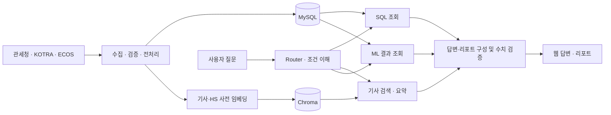

# Borderless Sellers

### 무역 통계·해외시장 분석 Agent

> 분산된 무역 통계와 해외시장 기사를 연결해, 시장 조사부터 분석·보고서 작성까지 돕는 서비스

관세청 수출입 통계와 KOTRA 해외시장 정보를 연결하여 **자연어 분석, 관심 정보 기반 조회, 요청형·정기 리포트**를 제공하는 웹 서비스를 개발합니다. 사용자가 품목·국가·기간을 정하면 통계를 조회하고, 관련 기사와 출처를 함께 제시하는 것이 목표입니다.

| 항목 | 내용 |
|---|---|
| 팀 | SK네트웍스 Family AI 33기 3팀 |
| 과제 주제 | 대화형 데이터 기반 분석 에이전트 및 자동 리포팅 플랫폼 |
| 프로젝트 기간 | 2026.09.28 ~ 2026.11.20, 8주 |
| 개발 범위 | 공공 데이터 기반 MVP |
| 저장소 | [SKN33-Final-3Team](https://github.com/20260528-skn-family-ai-33/SKN33-Final-3Team) |

**문서 기준:** 기능·구조는 요구사항 정의서와 기획서, 진행 상태는 중간발표 자료를 기준으로 정리했습니다. 아래 기능과 기술은 설계·개발 계획이며, 구현 완료나 성능 달성을 뜻하지 않습니다. 문서 간 수치·범위 차이는 해당 항목과 마지막 절에 표시했습니다.

## 목차

1. [프로젝트 소개](#1-프로젝트-소개)
2. [팀 소개](#2-팀-소개)
3. [주요 기능](#3-주요-기능)
4. [동작 구조](#4-동작-구조)
5. [데이터](#5-데이터)
6. [데이터 저장 구조](#6-데이터-저장-구조)
7. [신뢰성 설계](#7-신뢰성-설계)
8. [기술 스택](#8-기술-스택)
9. [평가 계획](#9-평가-계획)
10. [이슈와 대응](#10-이슈와-대응)
11. [진행 상황과 일정](#11-진행-상황과-일정)
12. [출처와 문서 확인 사항](#12-출처와-문서-확인-사항)
13. [실행 방법과 환경 변수](#13-실행-방법과-환경-변수)

## 1. 프로젝트 소개

### 배경과 문제

해외시장 조사에서는 품목의 HS 코드를 확인하고, 국가·기간별 통계를 조회한 뒤, 관련 기사를 찾아 변화를 해석하고 보고서로 정리하는 과정이 반복됩니다. 본 프로젝트는 이 과정을 자연어 질문과 관심 정보 설정으로 연결하고자 합니다.

```text
통계 조회 → 기사 검색 → 배경 해석 → 보고서 정리
      (조건 변경 시 반복 해야 함)
```

| 어려움 | 설계 방향 |
|---|---|
| 통계와 기사 정보를 각각 찾아야 함 | 조회 결과와 관련 기사 근거를 한 답변에 제공 |
| HS 코드와 조회 조건을 설정하기 어려움 | 자연어 조건 추출, 품목 후보 제시, 모호한 조건 되묻기 |
| 분석 결과와 현지 정보를 함께 해석해야 함 | 수치·차트와 기사 요약·출처 연결 |
| 같은 조건의 조사와 보고서 작성이 반복됨 | 관심 정보 저장, 요청형 리포트, 정기 구독 |

### 주요 사용자

- 수출입 기업의 해외영업 담당자
- 무역상사·수출입 컨설팅사
- 수출입 지원 기관 담당자
- 해외 구매 대행 개인사업자

### 기존 서비스와 프로젝트의 집중 방향

K-stat의 국가·품목별 통계 조회, KOTRA 해외시장뉴스의 시장·산업·통상 정보, TRASS의 무역통계·수출 유망국가 분석을 비교 대상으로 제시합니다.

기획서는 기존 서비스에도 유망시장 추천과 AI 기반 수출정보 기능이 있음을 전제로 합니다. 본 프로젝트는 **질문 이해 → 조건별 분석 → 근거 확인 → 관심시장 추적 → 리포트**를 연결하는 흐름에 집중합니다. 경쟁 서비스 대비 우위나 조사 시간 절감 효과는 측정된 성과로 제시하지 않습니다.


## 2. 팀 소개

| 이름 | 역할            | 주요 담당 업무                                              |
|---|---------------|-------------------------------------------------------|
| 이수연 | PM·데이터 평가·ML  | 범위·일정 관리, 지표·평가 기준, 급증·급감 및 일회성 추정 규칙, LLM 모델 선정, 프로젝트 총괄 |
| 김혜진 | APM·프론트엔드·리포트 | 리포트 에이전트, 프론트엔드·기사청크·임베딩·검색|
| 이양원 | DB 설계·백엔드     | LangGraph 통합, 데이터 적재·집계|
| 윤지환 | 데이터·ML        | SQL 에이전트, SQLGlot 검증 |
| 허유나 | 기획·RAG·프론트엔드  | 기획·기사청크·임베딩·검색, 근거 요약, 정답 SQL·평가 파이프라인|

역할 및 담당 업무는 추후 조정될 수 있습니다.

## 3. 주요 기능

| 기능 | 설계 내용 |
|---|---|
| 전체 시장·내 관심 메인 | 무역 추이, 국가·품목별 순위, 국가별 비중, 환율, 통합 기사 제공 | 
| 관심 정보 관리 | 품목·국가 등록, 관심 조건에 맞는 기사와 분석 제공, 시작 화면 설정 | 
| 자연어 AI 분석 | 질문에서 조건을 추출하고 통계·차트·근거 기사 제공, 후속 질문 처리 | 
| 시장 분석 | 국가별 성장률 순위, 급증·급감, 국가별 비중·성장 패턴 분석 | 
| 통합 기사 | 해외시장뉴스·단신속보를 함께 활용하고 관심 조건으로 필터링 | 
| 주요 이슈·급증 알림 | 기사량 변화와 관심 범위에 따라 이슈 표시·알림 제공 | 
| 요청형 리포트 | 품목·국가·기간과 포함 항목 선택, 비동기 생성, 저장·재열람 | 
| 정기 구독 리포트 | 주간·월간·분기 주기에 맞춘 자동 생성과 발행 알림 | 
| 대화 내역 | 세션별 저장, 다시 보기, 이어서 질문, 본인 내역 조회·삭제 | 

### 자연어 AI 분석

```text
질문 → 의도·조건 추출 → 품목·국가 확인 → 통계 조회·기사 검색 → 수치 검증 → 답변
```

- 품목은 HS 사전에서 검색하며, 모호하면 후보를 제시하고 사용자에게 확인합니다.
- 상대 기간은 데이터의 최신 공개 월을 기준으로 해석합니다.
- 기간을 지정하지 않으면 수출입 통계는 최근 12개월, 기사는 최근 3개월을 기본값으로 사용하도록 설계했습니다.
- 후속 질문은 이전 조건을 유지하면서 변경된 조건을 반영합니다.
- 답변에는 적용 조건, 수치·차트, 기준 기간과 출처를 표시합니다. 근거 기사는 관련 설명이 필요한 질문에 연결합니다.
- 데이터가 없거나 범위를 벗어난 질문에는 사유와 대안을 안내합니다.

### 통합 기사와 알림

발표자료에서는 두 기사 출처를 하나의 기사 테이블에 저장하고 국가·품목·키워드 태그를 연결하는 구조를 제시합니다. 단신속보의 품목·키워드는 본문에서 추출한 뒤 검증하는 방향이며, 제목이 비슷하다는 이유만으로 서로 다른 기사를 합치지 않습니다.

| 구분 | 문서에 제시된 판정 기준 |
|---|---|
| 관심 급증 | 어제 기사 수 ÷ 그 이전 7일 일평균이 2.5배 이상 |
| 주요 이슈 | 최근 7일 기사 수 ÷ 직전 8주 주평균이 3배 이상 |

비교 기간은 겹치지 않게 계산하고, 비교 평균이 0이면 1로 계산합니다. 발표자료는 수집이 정상 완료된 기간만 0건으로 인정하며, 알림 수신 설정과 동의 여부에 따라 팝업·알림함을 제공하는 기준을 제시합니다.

### 리포트

| 종류 | 발행 시점·조건 | 주요 구성 |
|---|---|---|
| 요청형 | 품목·국가·기간과 포함 항목 선택 후 생성 | 핵심 요약 + 선택한 섹션, 저장된 결과 재열람 |
| 주간 구독 | 매주 월요일, 직전 주 월~일 기사 대상 | 뉴스·이슈 중심, 통계 섹션 제외 |
| 월간 구독 | 새 월 통계 적재·검증 완료 후 | 핵심 요약, 주요 지표, 주요 수출국, 급성장·리스크 시장, 현지 이슈 |
| 분기 구독 | 분기 마지막 달 통계 적재·검증 완료 후 | 분기 지표, 전년 동분기 비교, 월별 3개월 추이 |

요청형 리포트의 흐름은 **조건 선택 → 항목 선택 → 조회·분석·기사 검색 → 작성·검증 → 저장·재열람**입니다. 
## 4. 동작 구조

### 데이터와 서비스 흐름



위 흐름은 공통 처리 구조를 요약한 것입니다. 모든 질문에서 SQL·RAG·ML을 전부 실행하지 않고, 질문 의도에 따라 처리 경로를 선택합니다.

| 질문 의도 | 처리 경로 |
|---|---|
| 단순 통계 | SQL → 수치 검증 → 답변 |
| 숫자와 이유 | SQL·RAG 병렬 처리 → 결과 결합 → 수치 검증 |
| 리포트 요청 | SQL·RAG·ML 결과 조회 → 리포트 작성 → 수치 검증 |
| 범위 밖 질문 | 사유·대안 안내 |

### 에이전트별 역할

| 구성 | 코드·도구가 수행하는 작업 | LLM의 역할                           |
|---|---|-----------------------------------|
| Router·데이터 이해 | 조건 스키마 확인, HS·국가 사전 조회, 실행 경로 연결 | 의도 분류, 품목·국가·기간 등 조건 추출, 후속 질문 해석 |
| SQL | SQLGlot 검사, 읽기 전용 DB 실행, 결과표 반환 | 조건과 스키마를 바탕으로 SELECT 초안 작성, 오류 수정 |
| ML | 배치 분석 결과와 국가 군집 결과 조회 | 분석 수치 계산에는 사용하지 않음                |
| RAG | 국가·품목·기간 필터와 Chroma 유사도 검색으로 근거 기사 검색 | 검색된 기사를 요약하고 출처에 근거한 설명 작성        |
| Report | 조회·분석 결과 조립, 표·차트 삽입, 템플릿 출력 | 핵심 요약과 설명문 작성                     |
| Verifier | 문장 속 수치·단위를 결과표와 대조 | 불일치로 판단된 문장의 재작성 요청               |

**RAG의 검색은 검색 도구가 수행하고, 검색 결과를 받은 LLM이 요약·설명을 작성합니다. 수치 계산과 수치 일치 판정은 코드가 수행합니다.**

### 프로젝트 구조
```
SKN33-Final-3Team/
├── .github/                      GitHub 설정
│   ├── ISSUE_TEMPLATE/           이슈 템플릿 (bug_report, feature---task)
│   └── PULL_REQUEST_TEMPLATE.md  PR 템플릿
├── .gitignore                    저장소에 올리지 않을 파일 목록
│
├── frontend/                     ① 사용자 화면 (React)
│   └── src/
│       ├── pages/                화면 단위: S00 로그인 ~ S11 마이페이지
│       ├── components/           여러 화면에서 같이 쓰는 부품 (알림 팝업, 차트, 기사 카드 등)
│       └── api/                  백엔드 API 호출 함수
│
├── backend/                      ②③④⑤ 서버 전체 (FastAPI + LangGraph + 스케줄러)
│   ├── app/
│   │   ├── routers/              ② API 엔드포인트
│   │   │                            auth, chat, market, my, alerts, reports, me, hs
│   │   ├── agents/               ③ AI 에이전트 (LangGraph)
│   │   │                            supervisor(라우터), sql, rag, verifier(검증 관문), report
│   │   ├── ml/                   ML 모델: 급변 탐지(Isolation Forest), 수출액 예측(Prophet/LightGBM),
│   │   │                            국가 군집(K-Means). 월 배치 때 학습하고, 결과는 DB에 저장
│   │   ├── scheduler/            ⑤ 배치 스케줄러 (APScheduler)
│   │   │   ├── main.py           스케줄러 실행: python -m backend.app.scheduler.main
│   │   │   ├── collectors/       ⑥ 외부 API 수집 — 호출과 파싱만 담당
│   │   │   │   ├── customs/      관세청 수출입실적 API (CUSTOMS_COLLECT_USAGE.md)
│   │   │   │   ├── news/         KOTRA 해외시장뉴스 (NEWS_COLLECT_USAGE.md)
│   │   │   │   ├── shortnews/    KOTRA 단신속보 (SHORTNEWS_COLLECT_USAGE.md)
│   │   │   │   └── hscode/       HS 코드 마스터 CSV 생성·UN 코드 대조 (HSCODE_USAGE.md)
│   │   │   └── jobs/             수집 → 검증 → 적재 → 알림 순서 실행
│   │   │                            hs_code_load.py(적재), hs_code_refresh.py(연간 자동 갱신)
│   │   ├── db/                   ④ MySQL 연결(session.py), 공통 CRUD(crud.py), 실행 기록(batch_log.py → batch_run)
│   │   ├── models/               SQLAlchemy 테이블 정의 (hs_code, service_option, batch_run …)
│   │   ├── schemas/              API 요청·응답 형식 (Pydantic)
│   │   ├── services/             라우터와 배치가 같이 쓰는 로직 (관심 범위 계산, 알림 생성 등)
│   │   └── templates/
│   │       └── reports/          리포트 Jinja2 템플릿 (HTML → PDF)
│   ├── requirements.txt          백엔드 패키지 (pip install -r backend/requirements.txt)
│   └── tests/                    백엔드 테스트 (python -m unittest discover backend/tests)
│
├── db/
│   └── mysql/
│       └── init/                 MySQL 초기 설정 SQL: 테이블 생성, 인덱스, 읽기 전용 계정
│
├── notebooks/                    데이터 탐색, ML 실험, 골든셋으로 LLM 비교
└── docs/                         프로젝트 문서 (아키텍처, 흐름도, API 명세 등)
```


## 5. 데이터


| 데이터 | 문서상 범위·규모 | 활용 |
|---|---|---|
| 관세청 품목별 국가별 수출입실적 | 6,456,048행, HS 10단위 원본. 요구사항·기획서: 2022.01~2025.12 / 발표: 2022.01~2026.08 | 추이, 국가·품목 순위, 증감·비중 |
| KOTRA 해외시장뉴스 | 2022.01~2026.09, 14,405건, 98개국 | 현지 시장·산업·통상 이슈 근거 |
| KOTRA 단신속보 | 2022.08~2026.09, 18,571건, 67개국 | 통합 기사 검색·요약 |
| 한국은행 ECOS 환율 | 일별 매매기준율, 43개 통화 | 주요 통화·관심 국가 환율, 직전 영업일 대비 변화 |
| UN 데이터 | 발표자료: 2022.01~2026.09, 36개 품목·247개 국가 | 해외시장별 한국 제품 점유율·경쟁국 비교 |
| HS·국가·지역·통화 사전 | 표준 코드와 명칭·매핑 정보 | 자연어 조건 검증, 품목·국가 해석 |

### 수집·갱신 설계

- 관세청: 월 1회 수집 후 검증·적재하고 집계·ML 결과를 갱신합니다.
- 해외시장뉴스: 매일 새벽 최근 3일치를 수집하여 누락을 보완하고, 기사 중복 제거·임베딩·집계를 수행합니다.
- 단신속보: 요구사항·기획서는 10분 주기, 발표자료는 매일 수집으로 기재되어 있습니다.
- 환율: 하루 1회 수집하고 화면에서는 저장된 값을 조회합니다. 주말·공휴일에는 직전 영업일 값을 사용합니다.
- 공통: 새 기사 0건과 수집 실패를 구분하고, 오류는 재시도·기록하며 검증 실패 시 이전 정상 데이터를 유지합니다.

### 전처리와 데이터 한계

- 수출·수입 0은 결측값으로 삭제하지 않고 보존합니다.
- 기획서에는 나미비아 국가 코드 `NA`가 결측으로 읽혀 누락된 1,498건을 수정한 사례가 기록되어 있습니다.
- 기사 본문 HTML 제거, 작성자명 미저장, 이메일·전화번호 마스킹을 적용하는 기준입니다.
- 단신속보는 국가별 기사 수에 편차가 있어 기사량 증가를 시장 변화로 해석할 때 확인이 필요합니다.
- 월별 합계 데이터로 개별 거래를 확인할 수 없으므로 일회성 거래 여부는 확정이 아닌 가능성으로 표시합니다.

## 6. 데이터 저장 구조

| 저장소 | 저장 대상 |
|---|---|
| MySQL | 무역 통계 원본·집계, 기사·태그·기사량 지표, 환율, ML 결과, 사용자 설정, 대화, 리포트, 알림 |
| Chroma | 기사 임베딩과 HS 사전 임베딩 |

- 기사 통합 저장·국가·품목·키워드 태그 연결은 중간발표 12쪽의 설계 방향입니다.
- 자주 쓰는 합계·순위는 집계 테이블을 활용하고, 분석용 DB 계정에는 읽기 권한만 부여합니다.
- ML 결과에는 학습 기간·모델·생성일을 함께 저장합니다.
- 리포트와 대화를 재열람할 때는 저장 당시 결과를 표시하고, 이어서 질문하면 복원한 조건으로 새로 조회합니다.

## 7. 신뢰성 설계

| 항목 | 설계 기준                                              |
|---|----------------------------------------------------|
| 표 | LLM이 생성한 숫자를 쓰지 않고 조회 결과를 코드로 직접 삽입                |
| 문장 속 수치 | 결과표와 대조, 불일치 시 1회 재작성 후에도 다르면 `확인 필요` 표시           |
| SQL 실행 | SELECT만 허용, LIMIT 강제, 허용 테이블 제한, 읽기 전용 계정·실행 시간 제한 |
| SQL 실패 | 최대 2회 재생성 후 실패하면 숫자 없이 조건 축소 안내                    |
| 품목 해석 | 사전에 있는 HS 코드만 사용, 모호한 품목은 사용자 확인                   |
| 근거 기사 | 설명에 기사 출처 연결, 관련 기사가 없으면 이유 요약 보류                  |
| 기준 기간·출처 | 통계·기사·환율 결과에 표시                                    |
| 실행 추적 | 실행 경로, SQL, 소요 시간, 결과 행 수·오류 기록                    |
| 개인정보·접근 | 개인정보 마스킹, 본인 대화만 조회·삭제, 질문 로그 3개월 후 삭제             |

## 8. 기술 스택

기획서에 제시된 기술과 후보입니다. 버전이 명시되지 않은 기술의 버전은 추가하지 않았습니다.

| 구분 | 기술·선정 상태 |
|---|---|
| 프론트엔드 | React |
| 백엔드 | FastAPI, SQLAlchemy |
| 에이전트 구성 | LangGraph, LangChain |
| LLM | 상용 LLM API, GPT 또는 Claude 후보 |
| DB·검색 | MySQL, Chroma |
| 임베딩 | 한국어 임베딩 모델, `bge-m3` 등이 후보 |
| ML | scikit-learn, 국가 군집을 위한 K-Means 계획 |
| 수집·전처리 | Python, requests, pandas, pyarrow |
| SQL 검증 | SQLGlot |
| 시각화·리포트 | Plotly, Jinja2 기반 HTML/PDF |
| 실행·스케줄 | Docker Compose, APScheduler |
| 형상 관리 | GitHub |

### 분석 방식과 ML 범위

| 분석 | 문서에 명시된 방법 |
|---|---|
| 유망시장 순위 | 국가별 수출 증가액·성장률 계산, 기준 기간 최소 수출액 필터 |
| 국가 성장 패턴 | 성장률·규모·변동성 기반 |

## 9. 평가 계획

**아래 값은 목표이며 실측 결과가 아닙니다.** 목표가 다른 항목은 문서별 값을 함께 기록했습니다.

| 평가 항목 | 측정 기준 | 중간발표 16쪽 |
|---|---|---|
| 통계 정합성 | 연도별 수출 합계와 공식 확정치 비교 | 차이 ±5% 이내 |
| SQL 정확도 | 정답 SQL의 결과표와 일치 여부 |  100% |
| 기사 검색 | 질문 50개 기준 Recall@5 |  0.7 이상 |
| 표·KPI 수치 일치 | 조회 결과와 출력 수치 대조 |  표 100% |
| 설명문 수치 일치 | 문장 속 숫자와 결과표 대조 |  70% 이상 |
| 출처·기간 표시 | 검수 대상에서 누락 여부 |  누락 0건 |
| 응답 시간 | 단순 조회 / 숫자+이유 / 요청형 리포트 | 10초 / 30초 / 20초 이내 |
| 쓰기 구문 차단 | UPDATE·DELETE 등 차단 | 100% | 

기획서는 골든셋 구축 후 목표값을 확정하도록 명시합니다. 리포트 시간은 요구사항에서 대표 조건의 생성 시간 중앙값으로 정의하지만, 발표자료에서는 `대표 조건 추출`로 표현되어 있어 측정 구간도 일치시켜야 합니다.

## 10. 이슈와 대응

| 이슈 | 확인된 내용 | 문서에 제시된 대응·상태 |
|---|---|---|
| HS 6단위의 `기타` 품목명 | 코드명만으로 품목 의미를 구분하기 어려움 | HS 4단위·6단위 정보를 결합하여 요약하는 방식 제시. 정확도 개선 수치는 없음 |
| 단신속보 국가 편향 | 일부 국가에 집중, 미국 59건·일본 49건으로 기재 | 해외시장뉴스와 병합, 추가 기사 수집 검토. 편향 해소 결과는 제시되지 않음 |
| 기사 분류·태그 부족 | 품목·키워드 검색에 필요한 원천 분류가 없거나 부족 | 키워드·품목 태그를 검색에 활용하는 방안 검토 |

## 11. 진행 상황과 일정

### 중간발표 시점의 진행 상태

| 단계 | 작업 | 상태    |
|---|---|-------|
| 기획·설계 | 요구사항 정의 | 완료    |
| 기획·설계 | 프로젝트 기획 | 완료    |
| 기획·설계 | 화면 설계 | 완료    |
| 기획·설계 | DB 설계 | 완료    |
| 데이터 | 데이터 수집 | 진행 중  |
| 데이터 | 데이터 적재·전처리 | 진행 중  |
| 모델·AI | 모델 개발 | 진행 예정 |
| 모델·AI | ML/DL 모델 학습·평가 | 진행 예정 |
| 모델·AI | LLM 기능 개발·AI 아키텍처 설계 | 진행 예정 |
| 통합·제출 | 통합 테스트·시스템 구성 | 진행 예정 |
| 통합·제출 | 웹 애플리케이션 개발·LLM 연동 | 진행 예정 |

### 기획서에 제시된 8주 일정

| 주차 | 기간 | 주요 작업 계획 |
|---|---|---|
| 1주 | 9.28~10.2 | 요구사항·지표 정의, DB 적재·검증, API 인증키 확보 |
| 2주 | 10.5~10.9 | 화면·DB·API 설계, 집계 테이블·품목 사전, 골든셋 50개 |
| 3주 | 10.12~10.16 | 데이터 이해·SQL 에이전트, SQL 검증, 품목 해석, 수집 스케줄러 |
| 4주 | 10.19~10.23 | RAG, 변화 판정·일회성 추정, Supervisor 분기, 채팅 화면 |
| 5주 | 10.26~10.30 | 요청형 리포트, 수치 검증, PDF 출력, 전체 시장 화면 |
| 6주 | 11.2~11.6 | 구독 리포트·알림, 관심사·마이페이지, 환율, 국가 군집 |
| 7주 | 11.9~11.13 | 통합 테스트, 골든셋 100개 평가·개선, 알림 기준 조정, 사용자 검수 |
| 8주 | 11.16~11.20 | 배포, 운영 문서, 발표·시연 준비 |

이 일정은 기획 당시 계획이며, 해당 주차가 지났다는 이유로 작업을 완료로 처리하지 않았습니다.

## 12. 출처와 문서 확인 사항

### 데이터 출처

| 데이터 | 문서에 기재된 출처 |
|---|---|
| 관세청 품목별 국가별 수출입실적 | [공공데이터포털](https://www.data.go.kr/data/15100475/openapi.do) |
| KOTRA 해외시장뉴스 | [공공데이터포털](https://www.data.go.kr/data/15034831/openapi.do) |
| KOTRA 단신속보뉴스 | [공공데이터포털](https://www.data.go.kr/data/15122662/openapi.do) |
| 한국은행 ECOS 환율 | [ECOS](https://ecos.bok.or.kr) |

## 13. 실행 방법과 환경 변수

### 실행 방법

전체 프로젝트가 아직 구현 중이어서 서비스 전체를 한 번에 실행하는 방법은 아직 없습니다. 지금까지 구현된 기능의 실행 방법은 각 폴더의 `*_USAGE.md` 파일에 정리해 두었습니다.

| 기능 | 실행 방법 문서 |
|---|---|
| 관세청 수출입실적 수집 | `backend/app/scheduler/collectors/customs/CUSTOMS_COLLECT_USAGE.md` |
| KOTRA 해외시장뉴스 수집 | `backend/app/scheduler/collectors/news/NEWS_COLLECT_USAGE.md` |
| KOTRA 단신속보 수집 | `backend/app/scheduler/collectors/shortnews/SHORTNEWS_COLLECT_USAGE.md` |
| HS 코드 마스터 생성·UN 코드 대조 | `backend/app/scheduler/collectors/hscode/HSCODE_USAGE.md` |

### 환경 변수 (.env)

저장소 루트의 `.env.sample`을 복사해 `.env`를 만들고 값을 바꿉니다. 실제 인증값은 `.env`에만 입력하고 커밋하지 않습니다.

```env
# 실제 인증값은 .env에만 입력하고 커밋하지 마세요.
# 해외시장뉴스 API
news=YOUR_NEWS_API_KEY
# 단신속보뉴스 API
shortnews=YOUR_SHORTNEWS_API_KEY

# MySQL 적재 설정 (적재 기능을 사용할 때만 설정)
MYSQL_HOST=localhost
MYSQL_PORT=3306
MYSQL_USER=YOUR_MYSQL_USER
MYSQL_PASSWORD=YOUR_MYSQL_PASSWORD
MYSQL_DATABASE=news_db
# 사용법: 이 파일을 복사해 저장소 루트에 .env로 만들고 값을 바꿉니다.

# 관세청 품목별 국가별 수출입실적 API (customs_collect.py)
# 발급: 공공데이터포털(data.go.kr) 로그인 → "관세청_품목별 국가별 수출입실적(GW)" 검색 → 활용신청
#       → 마이페이지 > 데이터활용 > Open API > 활용신청 현황에서 일반 인증키 복사 (Encoding·Decoding 어느 것이든 가능)
# 키 이름은 대소문자 구분 없음 (customs, CUSTOMS 모두 가능)
customs=YOUR_CUSTOMS_API_KEY

# HS 코드 마스터 6단위 품목명 요약 (hs_code_build.py)
OPENAI_API_KEY=YOUR_OPENAI_API_KEY
```
