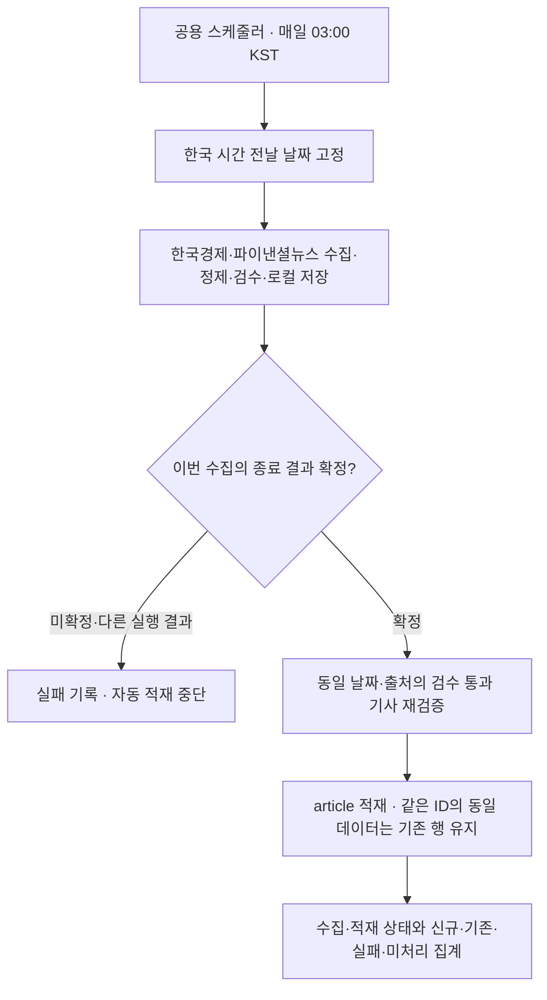

# 일일 무역 기사 크롤러 사용 설명서

## 1. 목적과 실행 범위

한국경제와 파이낸셜뉴스의 한국 시간 전날 게시 기사를 수집하고, 정제·검수를 통과한 기사를 로컬 SQLite와 JSON에 저장합니다. 약 10건은 참고 목표이며 강제 상한·하한이나 부족분 보충 조건이 아닙니다.

검수 통과 기사는 각각 독립 저장합니다. 기사 간 내용 비교·중복 판정·대표 선정은 하지 않습니다. 동일 URL 또는 같은 출처의 동일 기사 ID를 반복 저장하는 것은 방지합니다.

수동 일일 수집과 MySQL 기사 적재는 별도 명령입니다. 기본 `daily_collect.py`는 MySQL에 연결하지 않습니다. `--record-batch-run`을 명시한 경우에만 공통 DB에 실행 이력을 기록하며, 기사 적재는 여전히 별도입니다. 공용 스케줄러의 일일 기사 작업은 수집→적재를 연결하지만 기본 일시중지 상태입니다. 수동 수집 CLI만 실행하면 자동 적재하지 않습니다.

## 2. 실행 준비

이 문서와 `daily_collect.py`가 있는 `trade_news` 폴더에서 실행합니다. `python`은 실행 환경의 Python을 가리킵니다.

```sh
python -m pip install -r requirements.txt
```

기존 운영에서는 요청 예산과 차단 기록이 들어 있는 동일한 데이터 폴더를 지정합니다. 예산을 초기화하려고 별도 폴더를 만들어 실행하지 않습니다. 아래 `/기존/예산DB폴더`는 실제 운영 경로로 바꿉니다.

## 3. 전날 기사 수집

```sh
python daily_collect.py --data-dir /기존/예산DB폴더
```

- 기본 대상은 한국경제·파이낸셜뉴스입니다.
- 실행 시각을 한국 시간으로 변환하여 전날 날짜를 계산합니다.
- 예: 10월 22일 새벽 3시 실행은 10월 21일 게시 기사를 대상으로 합니다.
- 같은 대상 날짜로 다시 실행하면 재개 가능한 대기 항목을 이어 처리합니다.
- 실패·유료 제외·본문 없음 등의 처리 완료 상태를 자동으로 반복 요청하지 않습니다.
- 다음 날 기본 실행에는 과거 미완료분을 자동으로 섞지 않습니다.

원래 대상 날짜를 명시적으로 재개할 때:

```sh
python daily_collect.py --data-dir /기존/예산DB폴더 --target-date YYYY-MM-DD
```

한 언론사만 지정할 때:

```sh
python daily_collect.py --data-dir /기존/예산DB폴더 --sites hankyung
python daily_collect.py --data-dir /기존/예산DB폴더 --sites fnnews
```

### 새벽 3시 예약 (기본 일시중지)

공용 스케줄러에 `trade_news_daily`를 한국 시간 매일 03:00 일정으로 등록합니다. 기본 `NEWS_DAILY_ENABLED=false`에서는 일시중지된 잡만 등록하고 시작 직후 실행하지 않습니다. 향후 활성화하면 전날 수집→검증된 article 적재→결과 기록을 연결합니다. 현재 예약 프로세스를 실행하거나 Codex 예약을 활성화하는 작업은 하지 않았습니다. 설정·실패 처리와 검증 범위는 12절을 참고하세요.

## 4. 수집·검수 흐름

전날 계산 → 최신 사이트맵 → 전날 제목·URL·게시 날짜 확보 → 승인된 제목 후보 표시 → 동일 원문 처리 상태 확인 → 본문 요청 → 필수값 검증 → 원문 보존 → 정제·마스킹 → 품질·focus-v7.2.1 검수 → 각 기사 독립 저장 → 일일 집계.

### 탐색 범위

- 한국경제: https://www.hankyung.com/sitemap/latest-article.xml
- 파이낸셜뉴스: https://www.fnnews.com/sitemap/news/latest.xml

전체뉴스 목록·날짜별 사이트맵으로 자동 확장하지 않습니다. 최신 사이트맵에 없는 전날 기사는 확보하지 못할 수 있습니다.

제목은 본문 요청 대상을 탐색하는 데 사용합니다. 제목이 없거나 단서가 약한 항목도 목록에 보존하며, 본문을 확인하지 않은 기사를 비무역으로 확정하지 않습니다. 제목 후보와 최종 본문 통과는 서로 다른 결과입니다.

### 필수값·정제·무역 검수

- 제목·본문·게시 날짜·수집 시각·출처·기사 ID·URL의 필수값과 형식을 확인합니다.
- URL과 출처·기사 ID의 일치 여부를 검사합니다. 게시일은 날짜로 처리하고 수집 시각은 로그·예산을 위해 시간대를 유지합니다.
- 원문 `body`는 보존하고 서비스용 `body_masked`에 정제·마스킹을 적용합니다.
- 화면 문구·정해진 구독 홍보·기자 서명·장식 이모지·요약 이용 안내 등을 정리합니다. 사실·수치·인용·요약 내용은 유지합니다.
- 이메일·전화번호는 정규식으로 인식한 범위에서 마스킹하며, 변경 전후와 이유를 기록합니다.
- `focus-v7.2.1`은 정제된 본문 전체의 거래·규제·무역지원·해외 공급 활동 연결을 검사하는 규칙 기반 필터입니다.
- 제목·도입부·무역 문장 비율은 최종 판정의 필수 조건이 아닙니다. 유효한 한 문단 근거도 인정합니다.
- `keywords` 배열이 비어 있어도 본문 검수로 전달합니다.
- 본문 품질과 무역 검수를 모두 통과해야 정상 기사로 저장합니다.

## 5. 요청 제한과 오류 상태

| 항목 | 처리 기준 |
|---|---|
| 요청 간격 | 최소 60초, AutoThrottle 60~300초 |
| 동시 요청 | 전체·사이트별 1개 |
| 일일 상한 | 사이트별 한국 시간 하루 100회 |
| 예산 포함 | robots·사이트맵·본문·오류 응답·재시도 |
| 일반 목록 403 | 최소 60초 후 같은 URL 재시도, 최초 포함 총 3회. 소진하면 해당 경로 차단 |
| 본문 403·보안 확인 | 해당 사이트 중단, 수동 확인 필요 |
| 429 | Retry-After와 다음 한국 날짜를 반영해 중단. Retry-After가 없으면 수동 중단 상태 |
| robots 확인 실패 | 해당 사이트 중단. 명시적으로 금지된 요청은 실행하지 않음 |
| 사이트맵 구조 오류 | HTTP 200이어도 안내 HTML·깨진 XML·지원하지 않는 루트이면 목록 실패로 기록. 정상 빈 사이트맵과 전날 기사 0건은 실패가 아님 |
| 서버·네트워크 오류 | 연속 3회면 다음 한국 날짜까지 해당 사이트 중단 |
| 유료 확인 | `excluded_paid`로 제외. 홍보 문구만으로 유료 판정하지 않음 |
| 빈 HTTP 200 응답 | `completed_no_body`로 완료. 빈 기사는 적재하지 않음 |
| HTML 선택자 오류 | 실패 기록과 진단 HTML 보존. 저장 HTML을 확인하여 파서를 수정한 뒤 필요한 대상만 재처리 |
| 저장 실패 | 보고서에 오류 표시. JSON은 `export_pending`을 유지하여 재개 가능 |

수동 차단은 자동으로 해제하지 않습니다. 재시도 횟수와 다음 요청 시각은 DB에 유지합니다. 위 요청량은 자체 운영값이며 사이트가 보장한 허용량은 아닙니다.

## 6. 저장 결과 확인

모든 경로는 `--data-dir` 아래를 기준으로 합니다.

| 위치 | 내용 |
|---|---|
| `articles.sqlite3` | 통과 기사·원문 보존, 대기열·예산·차단·재시도 기록 |
| `prepared.sqlite3` | 원문 버전·정제 본문·품질·주제 판정·변경 이유 |
| `articles/` | 각 통과 기사 JSON |
| `daily_runs/YYYY-MM-DD/latest.json` | 대상 날짜의 목록·후보·검수·저장·오류·요청 집계 |
| `daily_runs/YYYY-MM-DD/unfinished.json` 및 `unfinished.txt` | 날짜별 대기·실패·차단 사유 |
| `run_summary.json`, `last_run.json` | 최근 수집 실행 요약 및 Scrapy 통계 |
| `events.jsonl`, `scrapy.log` | 이벤트·실행 로그 |
| `diagnostics/` | 추출 실패 등 진단용 HTML |

실행 후 대상 날짜, 사이트별 저장 수, 미통과·유료·본문 없음·실패·미처리, JSON 내보내기 상태를 확인합니다. 목록 확보 수를 해당 날짜 전체 발행량으로 해석하지 않습니다. 일일 실행은 전체 과거 저장 목록 보고서를 매번 다시 만들지 않습니다.


## 7. 프로젝트 MySQL 적재

### 구성과 사전 준비

- `load_project.py`: 기본은 적재 계획 확인, `--apply`에서만 실제 연결·저장.
- `news/project_articles.py`: 검수 통과와 정제 결과·저장 원문 일치 확인.
- `news/article_schema.py`: 기존 article 컬럼의 길이·자료형을 적재 계획과 INSERT 직전에 공통 검증.
- `news/mysql_store.py`: 기존 ERD의 `article` 컬럼에 적재.
- `requirements-mysql.txt`: 실제 MySQL 연결용 추가 의존성.

```sh
python -m pip install -r requirements-mysql.txt
```

기존 프로젝트 DB의 `article`, `service_option` 테이블과 활성 SOURCE 코드가 필요합니다. 기본 적재 범위는 `article`이며, 코드가 프로젝트 스키마를 자동 생성하지 않습니다. 국가·HS 사전은 기사 수집이나 기본 article 적재의 필수 조건이 아닙니다.

크롤러 출처와 팀에서 등록한 SOURCE 코드를 연결하는 JSON을 운영 환경에 준비합니다. `source_map.sample.json`과 SQL seed가 동일한 코드를 사용합니다.

```json
{
  "hankyung": "HANKYUNG",
  "fnnews": "FNNEWS"
}
```

날짜·출처 옵션이 없는 수동 적재 명령은 지정 DB의 통과 기사 전체를 읽습니다. 기존 DB에 다른 출처의 통과 기사도 있으면 그 출처의 매핑도 필요합니다. 서로 다른 언론사에 같은 SOURCE 코드를 지정할 수 없습니다.

### 연결 없이 적재 계획 확인

```sh
python load_project.py --data-dir /기존/예산DB폴더 --source-map /운영설정/source_map.json
```

`--apply`가 없으면 MySQL에 연결하지 않습니다. 대상 건수와 출처 매핑을 확인하며 실제 서버의 SOURCE 등록·외래 키·SQL 동작까지 검증하는 것은 아닙니다.

### 실제 적재

저장소 루트의 `.env.sample`을 참고해 `.env`에 다음 변수를 설정합니다. 적재 코드는 작업 디렉터리와 관계없이 저장소 루트 `.env`를 읽으며, 같은 이름의 실행 환경변수가 있으면 그 값을 우선합니다. 실제 값이나 `.env` 파일은 Git에 포함하지 않습니다.

변수명과 우선순위는 기존 백엔드의 `backend/app/db/session.py`와 같습니다. `NEWS_DB_*` 변수는 사용하지 않습니다.

- `MYSQL_HOST`
- `MYSQL_USER`
- `MYSQL_PASSWORD`
- `MYSQL_DATABASE`
- `MYSQL_PORT`: 선택, 미설정 또는 빈 값이면 기본 3306

대상 DB와 적재 계획을 확인한 뒤 실제 저장이 필요할 때만 실행합니다.

```sh
python load_project.py --data-dir /기존/예산DB폴더 --source-map /운영설정/source_map.json --apply
```

적재 컬럼은 `source_code`, `external_id`, `title`, `published_date`, `source_url`, `body_masked`, `category`입니다. `article_id`는 DB 생성 식별자이며 `category`는 현재 기본 NULL입니다.

동일 SOURCE·기사 ID의 동일 데이터는 재삽입하지 않습니다. 같은 식별자의 내용이 다르면 기존 데이터를 자동 덮어쓰지 않고 충돌로 중단합니다. 기사별 트랜잭션이므로 중간 실패 전에 완료된 기사는 남을 수 있으며, 원인 해결 후 같은 식별자로 재실행할 수 있습니다.

`--include-tags`는 선택 기능입니다. 사용할 때만 `article_tag`와 필요한 사전·외래 키를 별도로 준비합니다. 기본 명령은 태그를 적재하지 않습니다.

## 8. 커밋 범위

현재 커밋 목록은 일일 운영 코드, MySQL 적재 코드·추가 의존성, 이 사용 설명서로 구성됩니다. 합성 자료 기반 clean·focus·traffic·mysql_store 및 연결 회귀 테스트는 backend/tests/trade_news에 포함합니다. 실제 기사 시험 자료는 포함하지 않습니다.

실제 기사 원문·수집 HTML·SQLite DB·로그·환경 파일·실행 결과는 커밋 대상이 아닙니다. 이 문서에는 해당 파일을 읽고 생성하는 방법만 설명하며 실제 운영 데이터나 접속 비밀 값은 포함하지 않습니다.


## 9. 출처·집계·실패 처리

- `backend.app.db.session.make_engine()`의 SQLAlchemy+PyMySQL 연결을 공유합니다. mysql-connector-python은 사용하지 않습니다.
- 메타데이터 조회 전에 기사별 트랜잭션을 시작합니다. 본문 또는 태그 저장 실패는 해당 기사를 롤백합니다. 이전에 커밋한 기사는 유지합니다.
- 적재 결과는 `--result-file`에 inserted·existing·failed·unprocessed·rejected로 기록합니다. 접속 오류에는 비밀 값 대신 예외 종류만 기록합니다.
- `focus-v7.2.1`는 v7.1의 본문 전체 판정을 유지하고 소득 의미의 수입을 무역 근거로 세던 오류를 수정합니다. 동음이의어 판별은 규칙 기반이므로 완전한 의미 이해를 보장하지 않습니다.
- 신규 DB seed에 HANKYUNG·FNNEWS를 등록합니다. 기존 DB는 `db/mysql/migrations/20261022_trade_news_sources.sql`을 검토 후 별도 적용해야 합니다. 코드는 자동 실행하지 않습니다.
- `v_article_day`, `v_article_country_day`는 KOTRA_MARKET·HANKYUNG·FNNEWS를 조회합니다. 실제 source_code를 보존하며 다른 출처로 위장하지 않습니다.
- 국가별 뷰에는 국가 태그가 있는 기사만 포함됩니다. 기본 article 적재만으로 국가 태그가 자동 생성되지는 않습니다.
- 원문·정제 전후 기록·진단 HTML의 로컬 보존 구조를 유지합니다. MySQL article에는 body_masked만 적재합니다.

## 10. 로컬 검증

저장소 루트에서 `python -m pytest backend/tests/trade_news`를 실행합니다. 기본 테스트는 외부 소켓 연결을 차단하고 합성 본문·SQLite·가상 HTTP 응답만 사용합니다. 실제 MySQL 테스트는 별도 명시 옵션과 전용 임시 테스트 DB 설정이 있을 때만 실행합니다. 자세한 명령은 해당 테스트 폴더 README를 참고하세요.

### 준비 데이터 오류 집계

과거 준비 결과의 JSON·게시 날짜 오류는 일일 집계를 중단시키지 않습니다. 정상 기사는 계속 집계하고 `data_issues.prepared_errors`에 출처·기사 ID·확인 가능한 날짜·원인을 기록합니다. `counts.prepared_data_errors`는 오류 행 수이며 신규 수집 실패 건수와 다릅니다. 날짜를 해석하지 못한 행은 날짜 미상으로 표시하고 임의로 과거 날짜에 배정하지 않습니다. 원문·준비 데이터·기존 검수 결과는 수정하거나 자동 재수집하지 않습니다.

`focus-v7.2.1`에서는 명시적인 개인·가계 소득 문맥을 먼저 구분합니다. 수입액·달러라는 표현만으로 개인 소득을 교역으로 인정하지 않으며, 같은 본문의 실제 상품 수입·관세·수출 근거는 계속 인정합니다.

### 실행 중단과 이전 성공 결과 구분

수집기는 데이터 폴더 잠금을 획득한 뒤 DB 초기화·수집 전에 시작 상태를 확정합니다. 관리 명령(`--status`, `--resume-site`, `--requeue-url`)은 새 수집 실행을 만들지 않습니다.

| 파일 | 의미 |
| --- | --- |
| `current_run.json` | 실행 상태의 유일한 확정 기준. 현재 상태와 날짜별 최신·마지막 성공·이력의 결과 참조를 함께 보관 |
| `run_records/*.json` | 실행별 결과 묶음. 새 파일로 저장하며 덮어쓰지 않음. 확정 파일에서 참조된 결과만 확정된 결과 |
| `run_summary.json`, 날짜별 `latest.json` | 확정 결과에서 생성하는 표시용 보고서 |
| `last_success_summary.json`, 날짜별 `last_success.json` | 확정된 마지막 정상 결과의 표시용 복사본 |
| `run_history/*.json`, 날짜별 `attempt_*.json` | 확정된 실행 이력을 표시하는 복사본 |

결과 묶음을 먼저 저장하고, `current_run.json`을 원자적으로 교체하여 현재 상태·최신 결과·성공 결과를 한 번에 확정합니다. 이 확정 전에 실패하면 기존 성공 참조는 유지됩니다. 이후 표시용 파일 출력만 실패하면 확정된 성공을 실패로 번복하지 않습니다. `pending_scopes`·`pending_history`에 출력 대기가 남고 stderr에 원인이 표시되며 CLI는 종료 코드 1을 반환합니다. 수집 실패(`execution_error`)와 보고서 출력 대기는 구분합니다.

표시용 파일은 여러 개이므로 쓰는 도중에는 시점이 다를 수 있습니다. `current_run.json`이 기준이며, `pending_scopes`·`pending_history`가 비어 있고 시도 ID가 일치하는지 확인합니다. 비어 있지 않으면 `latest`·`success`가 가리키는 `run_records`의 확정 결과를 사용합니다. `latest`와 `success`의 `_global`은 전체 실행, 날짜 키는 해당 날짜 결과입니다. 낡거나 손상된 표시용 파일을 확정 기록으로 다시 가져오지 않습니다.

`running`은 실행 중 또는 종료 미확정이며 성공을 뜻하지 않습니다. 다음 수집 실행이 잠금을 획득하면 이전 `running`을 `interrupted`로 확정하고, 그 실행의 날짜별 최신 보고서도 확정 기록에 맞춰 복구합니다. 표시용 파일에 이전 성공 ID가 남아 있어도 복구합니다. 다른 날짜에 실행하더라도 과거 기사 본문은 자동 재수집하지 않습니다.

각 시도는 고유 `attempt_id`를 사용합니다. `TRADE_NEWS_RUN_ID`는 외부 연계용으로 유지합니다. `completed`는 수집 결과의 정상 확정을 뜻하며 기사 전수 확보·모든 후보 완료를 보장하지 않습니다. 기존 예산·차단·미완료 상세 항목도 확인합니다. 확정 직후 프로세스가 종료되어도 다음 실행은 이를 성공에서 중단으로 되돌리지 않고 남은 보고서 출력만 복구합니다.

같은 날짜로 재실행하면 기존 대기열·원문·예산을 유지하며, 이미 저장한 본문을 다시 요청하지 않고 JSON 내보내기·집계를 복구합니다. 이전 형식의 정상 보고서는 최초 사용 때 확정 기록으로 보존합니다. 디스크 자체가 쓰기 불능이거나 확정 파일이 손상된 경우에는 stderr로 알리고 수집을 시작하지 않습니다. 시스템 전원 차단으로 인한 파일 시스템 자체의 손상까지 보장하는 기능은 아닙니다.


## 11. batch_run 실행 이력 연결

### 사용 여부와 진입점

`news/batch_history.py`가 팀 공통 SQLAlchemy 연결과 `ServiceOption` 모델을 사용하고, `batch_run`의 실제 컬럼을 조회해 기록합니다. 기존 상태 값은 그대로입니다. 관리자 ERD에서는 신규 행에 필수 `detail_json={"schema_version":1}`을 공급하며 기존 행 갱신 시 상세 정보는 덮어쓰지 않습니다. 이력용 SOURCE는 기존 활성 `HANKYUNG`·`FNNEWS`를 사용하며, 코드가 SOURCE나 테이블을 자동 생성하지 않습니다.

추가 의존성은 기존 `requirements-mysql.txt`와 같습니다. 운영 DB 연결을 준비한 뒤, 이력 기록이 필요할 때 다음 옵션을 명시합니다. 아래는 사용법이며 로컬 검증에서는 실제 명령으로 원격 DB에 연결하지 않았습니다.

```sh
# 수집 + 실행 이력. article 테이블 INSERT는 하지 않습니다.
python daily_collect.py --data-dir /기존/예산DB폴더 --record-batch-run

# 날짜·출처를 지정한 별도 기사 적재 + 적재 실행 이력
python load_project.py --data-dir /기존/예산DB폴더 --source-map /운영설정/source_map.json --target-date YYYY-MM-DD --sites hankyung fnnews --result-file /운영결과/load_result.json --apply --record-batch-run
```

`crawl.py`, `collect.py`도 같은 `--record-batch-run`을 받습니다. 기본 수집 명령과 상태 조회·중단 해제·대기열 관리 명령은 이력 DB를 연결하지 않습니다. `load_project.py`는 `--apply` 없는 계획 조회이면 이력 옵션이 있어도 DB에 연결하지 않습니다. 옵션을 추가한다고 예약이 등록되거나 기사 자동 적재가 실행되지는 않습니다.

### 기록 내용

한 실행에 대상 출처마다 한 행을 기록합니다. 동일 날짜 재실행은 새로운 실행 이력이며, 기존 성공 기록을 덮어쓰지 않습니다. 수집과 적재는 별도 이력입니다.

| 컬럼 | 수집 COLLECT | 적재 LOAD |
| --- | --- | --- |
| `source_code` | HANKYUNG / FNNEWS | 적재 명령의 SOURCE 매핑 값 |
| `job_name` | `TRADE_NEWS_COLLECT:<attempt_id>` | `TRADE_NEWS_LOAD:<attempt_id>` |
| `target_table` | article (최종 대상, MySQL 적재 완료 의미 아님) | article |
| `period_start`, `period_end` | 일일 대상 게시 날짜 | 명시한 대상 게시 날짜 |
| `status` | RUNNING → SUCCESS / FAILED | RUNNING → SUCCESS / FAILED |
| `request_count` | 실행 중 예산을 차감하고 요청한 횟수. robots·목록·본문·재시도 포함 | 0 (기사 HTTP 요청 없음) |
| `received_count` | 본문 추출 성공 건수. 날짜·품질·주제 검수 통과 건수와 다름 | 적재기에 전달한 검증된 기사 수. 신규 INSERT 건수와 다름 |
| `started_at`, `finished_at` | 한국 시간 기준 시작·종료 | 한국 시간 기준 시작·종료 |

일일 명령은 항상 대상 날짜가 있습니다. 수동 수집은 명시한 기간을 기록합니다. 한쪽 날짜만 있으면 그 날짜를 양쪽에 기록하고, 날짜를 전혀 지정하지 않은 수동 실행은 실행일을 기록용 기준일로 사용합니다. 이것이 과거 기사 처리 범위를 제한하거나 전수 검수를 뜻하지는 않습니다. 날짜별 이력이 필요한 적재는 `--target-date`를 지정합니다.

`job_name`에 시도 ID를 넣어 DB 커밋 직후 종료되어도 동일 이력을 다시 찾습니다. 종류별 조회는 `TRADE_NEWS_COLLECT:%`, `TRADE_NEWS_LOAD:%` 접두사를 사용합니다. 한 수집 실행의 여러 출처 행은 동일 실행 종료 상태를 공유하고, 요청·수신 건수는 출처별입니다.

수집 SUCCESS는 기존 `current_run.json`의 정상 완료 확정에 대응합니다. 예산 소진·수동 차단·후보 잔여가 없다는 의미는 아니므로 날짜별 보고서와 `batch_runs`의 사이트 상태도 함께 확인합니다. 적재는 기존 결과 `complete`일 때 SUCCESS, `partial`·`failed`·종료 미확정일 때 FAILED입니다. INSERT·기존 동일 기사·실패·미처리는 기존 적재 결과 파일에서 구분합니다.

### 기록 실패와 재실행 복구

`--data-dir/batch_runs/<attempt_id>.json`은 DB 실행 ID·요청/수신 건수·종료 상태·이력 동기화 여부를 보존합니다. 기사 본문이나 접속 비밀번호를 넣지 않습니다. 이력 DB 오류는 stderr와 `sync_pending`, `sync_error_type`으로 구분하며 기사 수집·저장을 취소하지 않습니다. 같은 실행 중 DB 오류가 반복되면 접속을 계속 반복하지 않고 로컬 기록만 갱신합니다.

다음에 동일 데이터 폴더·DB에서 이력 옵션을 켜고 실행하면, 잠금 획득 후 남은 이력을 먼저 복구합니다. 수집의 완료 확정 기록이 있으면 SUCCESS를 유지하고, 완료 확정 전 강제 종료된 수집이나 종료 기록 없는 적재는 FAILED로 정리합니다. 종료 시각을 알 수 없는 강제 종료는 복구 확인 시각을 기록하고 `recovered_at`으로 구분합니다. 기사 원문·예산·대기열을 초기화하거나 과거 기사를 자동 재수집하지 않습니다.

DB 커밋과 로컬 확인 기록 사이에 종료되어도 출처·실행 ID로 기존 이력을 찾아 갱신하므로 같은 이력 행을 다시 만들지 않습니다. 연결 대상 DB가 달라진 과거 파일은 다른 DB로 복제하지 않습니다. 이전 이력의 복구는 같은 연결에서 다시 실행해야 합니다. 로컬 파일 자체를 쓸 수 없으면 stderr로 알리며 복구 가능한 기록을 보장할 수 없습니다.

### 이번 검증 범위

합성 기사·가상 HTTP·임시 SQLite로 공통 모델의 시작/종료, 건수, 실패 분리, 동일 기사 재적재, 강제 종료 및 재실행을 검증합니다. 실제 MySQL의 서버 SQL·권한·네트워크 지연과 실제 새벽 예약 실행은 별도 검증 범위입니다.


## 12. 공용 스케줄러 → 수집 → article 자동 적재

### 연결된 코드

- `backend/app/scheduler/main.py`: 기존 작업을 유지하며 `trade_news_daily.register_jobs()` 호출.
- `backend/app/scheduler/jobs/trade_news_daily.py`: 03:00 KST 일정 등록, 실행 날짜 고정, 전체 작업 잠금, 자식 수집·적재 연결, 실행 결과 기록.
- `daily_collect.py`: 공통 `collect.command()`로 옵션을 구성한 뒤 같은 자식 프로세스에서 `crawl.py`를 실행합니다. 별도 손자 프로세스 없이 기존 사이트맵·제목 후보·정제·본문 검수·예산·차단 기준으로 수집합니다.
- `load_project.py --apply`: 동일 날짜·두 언론사의 저장된 검수 통과 기사만 기존 검증을 거쳐 `article`에 적재.
- 두 자식에 `--record-batch-run`을 전달해 수집·적재 이력을 구분해 기록.



### 설정과 중단 상태

`.env.sample`에 공개용 설정 이름만 추가했습니다. 실제 `.env`와 기존 운영 데이터는 변경하지 않습니다.

| 설정 | 의미 |
| --- | --- |
| `NEWS_DAILY_ENABLED=false` | 기본 중단. 향후 실제 운영 승인 후 true로 설정하고 공용 스케줄러를 실행해야 활성화 |
| `NEWS_CRAWL_DATA_DIR` | 기존 `articles.sqlite3` 요청 예산 DB가 있는 폴더. 경로가 없으면 새 DB를 만들어 진행하지 않음 |
| `NEWS_SOURCE_MAP` | 선택. 비우면 크롤러 `source_map.sample.json` 사용. 자동 작업은 팀 코드 HANKYUNG·FNNEWS와 일치해야 함 |
| `MYSQL_*` | 기존 공통 SQLAlchemy+PyMySQL 설정. 별도 기사 DB 인증 변수를 추가하지 않음 |

공용 스케줄러 실행 환경에는 저장소 루트의 `backend/requirements.txt` 의존성이 필요합니다. 자식은 공용 스케줄러와 같은 `sys.executable` Python을 사용합니다. 수집·적재에 필요한 의존성은 백엔드 requirements에 포함돼 있습니다. 상대 경로 설정은 저장소 루트 기준으로 해석합니다.

일정 등록만으로 프로세스가 시작되지는 않습니다. 코드 import·일정 구성 시에는 사이트/DB에 연결하지 않습니다. 향후 활성화된 잡은 `max_instances=1`, 실행 중첩 합치기(coalesce), 기존 공용 작업들과 같은 6시간 지연 허용을 사용합니다. 기사 작업을 시작 즉시 실행하는 별도 잡은 없습니다. Codex 앱의 일일 예약과 공용 스케줄러는 서로 다른 예약이며, 이번 작업은 둘을 실제 실행하지 않습니다.

### 날짜·실패·재실행

시작 시 KST 전날을 한 번 계산하고 수집·적재에 동일하게 전달합니다. 실행 중 날짜가 바뀌어도 대상이 달라지지 않습니다. 다른 날짜의 기사를 자동 보충하거나 과거 미완료분을 자동 적재하지 않습니다.

`daily_job.lock`은 전체 작업의 중복 실행을 막습니다. 새 실행은 기존 `crawler.lock`도 확보한 뒤 이전 상태를 복구하고 새 실행 ID를 기록합니다. 부모만 종료되어 자식이 이 잠금을 보유하면 `already_running`과 `active_lock`을 반환하며, 새 요청·적재를 시작하거나 기존 상태를 실패로 덮어쓰지 않습니다. 자식 종료 후 같은 날짜로 다시 호출하면 기존 기사 재요청·재삽입 없이 이어갑니다. 자동 재시도를 추가하지 않습니다. 이미 처리한 동일 URL/기사 ID는 기존 기준대로 본문 재요청·중복 INSERT를 방지합니다. 기사 간 내용 중복 처리는 추가하지 않습니다.

수집 결과는 표시용 `latest.json` 대신 `current_run.json`과 해당 `run_records`의 실행 ID·날짜·출처가 맞는 종료 확정 결과를 사용합니다. 강제 종료로 결과가 미확정되었거나 이전 실행의 보고서이면 적재를 시작하지 않습니다. 종료가 확정된 일부 실패 실행은 정상 저장된 기사만 적재기의 기존 검증으로 다시 확인하되, 수집 실패를 전체 성공으로 바꾸지 않습니다. 예산 소진·사이트 차단·미처리 후보가 있으면 부분 완료로 표시합니다. 정상 0건은 완료이며 부족분을 채우지 않습니다.

적재 결과도 고유 실행 ID·대상 날짜·출처·적재 모드를 확인합니다. 동일 ID에 다른 본문이 있으면 기존 값을 덮어쓰지 않고 충돌로 중단합니다. 이미 커밋된 정상 기사는 보존하고 다음 같은 날짜 실행에서 기존 행으로 확인합니다.

| 기록 | 의미 |
| --- | --- |
| `current_job.json` | 수집→적재 전체 작업의 현재 상태 기준. 작업 시작 전에 running 기록. 건수·상태와 상세 파일 참조만 보관 |
| `daily_runs/날짜/job_실행ID.json`, `job_latest.json` | 실행별 요약 이력과 날짜별 표시용 복사본. 전체 기사 목록을 중복 복사하지 않음 |
| `collection.report_file` | 데이터 폴더 기준 `run_records/파일.json` 참조. 내부 `daily`에 상세 수집 결과 보존 |
| `mysql.result_file` | 데이터 폴더 기준 적재 상세 JSON 참조. 기사별 결과·제외 사유 보존 |
| `daily_runs/날짜/mysql_실행ID.json` | 해당 적재의 신규·기존·실패·미처리와 batch_run 기록 상태 |
| `daily_runs/날짜/job_실행ID.log` | 두 자식 프로세스 로그 |
| 저장소 `tmp/trade_news_job_errors/` | 기존 데이터 경로를 확인할 수 없는 설정 실패. 예산 DB를 새로 만들지 않음 |

다음 실행이 부모·자식 잠금을 모두 얻으면 이전 running 작업을 interrupted로 기록합니다. 내부 실행 환경값 `TRADE_NEWS_JOB_RUN_ID`로 자식은 잠금 획득 직후 현재 실행 ID·진행 단계를 확인합니다. 새 실행으로 교체된 뒤 늦게 시작한 이전 자식은 요청·기사 저장·DB 이력 기록 전에 중단합니다. 이 내부 값은 스케줄러가 전달하며 `.env`에 추가할 설정이 아닙니다. 수동 CLI에는 기존 기준이 적용됩니다. 과거 날짜의 상태만 정리하며 과거 기사를 다시 수집하지 않습니다. 현재 상태 파일이 확정 기준이며 표시용 파일 출력 오류는 `report_errors`로 구분합니다. 디스크 자체에 기록할 수 없으면 로그에 실패를 남기며 정상 완료로 간주하지 않습니다.

검증에서는 일정 정의만 구성하고 스케줄러를 시작하지 않습니다. 합성 HTTP와 임시 SQLite로 작업 함수를 직접 호출해 두 언론사 수집→정제→검수→article 적재→뷰 집계→batch_run을 검사합니다. 실제 사이트 요청, MySQL 적재, 새벽 예약 실행은 별도 운영 검증입니다.

JSON 파일의 안전한 저장은 `news/run_lifecycle.py`의 공통 `atomic_json()`을 수집·상위 작업·적재 결과에서 재사용합니다. 파일 역할과 기존 원문 보존 방식은 유지합니다.

## 13. 관리자 ERD에 맞춘 적재

`news/mysql_store.py`는 실제 `article` 컬럼을 조회하고 공통 `backend/app/services/news_schema.py`를 사용합니다. 이 공통 파일도 배포 대상에 포함해야 합니다. 테이블을 수정하지 않으며, 관리자 컬럼이 없는 기존 ERD도 지원합니다.

| 대상 | 신규 저장 | 동일 원문 재실행 |
| --- | --- | --- |
| `article.visibility_status` | VISIBLE | 기존 공개·숨김 상태 보존 |
| `article.first_ingested_at` | 최초 적재 시각, 한국 시간 | 최초 시각 보존 |
| `article.admin_meta_json` | 관리자 기본값, 정책 스냅샷 참조·SHA-256, 분류 상태 PENDING | 관리자 정보·기존 정책 참조 보존 |
| `batch_run.detail_json` | schema_version 1 | 상세 정보 보존, 실행 상태·건수만 갱신 |

`--include-tags` 사용 시 관리자가 수동 확정한 국가·HS 종류에는 자동 태그를 추가하지 않습니다. 기존 태그를 삭제하지 않으며 키워드 태그의 동일 값 재저장 방지는 유지합니다. 동일 출처·기사 ID의 본문이나 필수 정보가 달라지면 기존 내용처럼 충돌로 중단합니다.

정책 스냅샷은 저장소의 `data/news/classification_snapshots/`에 기록합니다. 최초 적재 당시의 분류 코드·사전·DB 정책 자료이며 기사 본문은 포함하지 않습니다. 과거 수집 시점의 정책을 소급 복원하는 자료나 분류 완료 결과는 아닙니다. DB의 참조와 함께 이 폴더도 보존해야 합니다. 스냅샷 쓰기 실패 또는 같은 해시 파일의 내용 불일치가 발생하면 해당 신규 기사 트랜잭션을 롤백합니다.

관리자 제약을 재현한 임시 SQLite에서 신규 적재·관리자 설정 보존·정책 변경·강제 종료 후 재실행을 확인합니다. 2026-10-23 로컬 MySQL 8.4.11에서 실제 JSON CHECK·트리거·트랜잭션·적재·집계·재실행 복구를 포함한 15개 시험이 통과했습니다. 임시 시험 DB는 삭제했고 서버는 종료했습니다. RDS의 계정 권한·접속·동시 운영 조건은 검증하지 않았습니다. 수집 범위·focus 검수·원문 보존·요청 예산·예약 중단 상태는 변경하지 않습니다.
