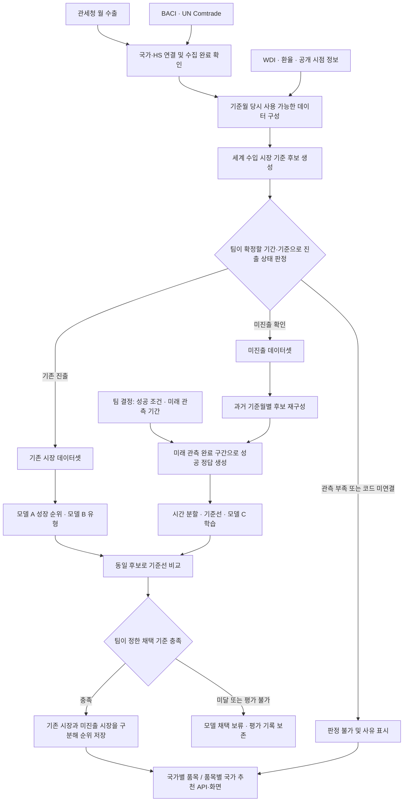

# 미진출 시장 발굴 ML 개발 계획

작성일: 2026-10-21. 기존 구현 검토 기준: `bdf7e601d8c45b4166b83b935d5fe5f162a24f2d`. 코드 수정 사항과 추가 개발 계획을 구분한다.

**미진출 시장 발굴은 이번 프로젝트의 구현 범위에 포함한다.** 현재 구현된 모델 A는 기존 수출 쌍의 성장 예측이고, 모델 B는 시장 유형 분류다. 이번 수정본도 미진출 시장 발굴 전체가 구현된 상태는 아니다. 미진출 후보 생성·성공 라벨·별도 학습·평가·서비스 연결을 아래 순서로 추가해야 한다.

**미진출 판정 기간과 신규 진출 성공 기준은 아직 미정**이다. 이 문서의 개발안은 그 값을 정하지 않으며, 해당 값에 의존하는 기능은 결정 후 구현한다.

## 1. 현재 코드에서 확인한 사실

| 확인된 사실 | 의미 | 근거 |
|---|---|---|
| 후보는 관세청 수출 테이블에 등장한 국가·HS6 쌍으로 생성된다 | 전세계 수입 시장에 존재해도 한국 수출 기록이 없는 쌍은 후보에 들어오지 않는다 | `features.py`의 `rows`, `_matrix` |
| 최근 12개월 수출액 $100,000 이상만 남긴다 | 단순히 외부 CSV를 붙이는 것으로 미진출 추천이 구현되지 않는다 | `build_dataset`의 `keep` |
| 모델 A 정답은 향후 12개월 수출합과 최근 12개월 수출합의 로그 차이다 | 미진출 성공 여부를 직접 학습하는 모델이 아니다 | `y_growth`, `fit_a` |
| 모델 B의 ‘고성장·진입형’은 기존 후보 안에서 매기는 유형명이다 | 이름에 ‘진입’이 있어도 신규 시장 후보를 생성하지 않는다 | `market_type`, `past_type` |
| 수정본은 누락 월을 보존하고 금액 미관측 시 계산을 중단한다 | 누락→0 결함은 수정. 전체 수집 완료 증명과 미진출 상태 판정은 별도 구현 필요 | `_matrix`, `_require_observed` |
| 외부 CSV는 이미 존재한다 | 추가로 필요한 것은 아래의 관측 상태·시점 정보와 미진출용 학습 구성이다 | 실제 파일 및 수집 코드 확인 |

이 프로젝트의 관세청·BACI·Comtrade 자료로 확인할 수 있는 대상은 **한국→상대국의 국가·품목별 진출 상태**다. 개별 기업의 미진출 여부를 뜻하지 않는다. 기업별 추천으로 확장하려면 기업별 수출 이력이 별도로 필요하다.

## 2. 사용할 데이터와 아직 필요한 데이터

외부 CSV의 표준 위치는 저장소 루트의 `data/external/`이다. 아래 수량은 2026-10-21 검토한 파일의 범위다. 팀원 보유본의 버전·범위는 사용 전에 대조하며, 이 변경에 CSV 파일을 포함하지 않는다.

| 자료 | 실제 보유 범위 | 미진출 개발에서 쓰는 항목 | 남은 확인 |
|---|---|---|---|
| BACI HS22 | 2022~2024, 2,682,674행, 국가·지역 코드 226개 | 연도·수입국·HS6, 세계 수입액, 한국발 수입액 | 원천에 없는 쌍과 실제 무거래 구분, 국가·HS 연결 |
| UN Comtrade | 2025, 526,758행, 코드 114개 | BACI 이후 시장 규모·한국발 수입 보충 | 미신고 국가와 한국 파트너 행 부재를 0으로 오판하지 않기 |
| WDI | 2022~2025, 868행, 코드 217개 | GDP, GDP 성장률, 인구, 1인당 GDP | GDP·성장률·1인당 GDP 각 69개 결측, 인구 결측 없음 |
| 관세청 월별 수출 | 수집·적재 상태 별도 확인 필요 | 한국→국가·HS별 월 수출액, 관측 기간 | 조회 범위·완료 상태와 누락 월, 연속된 과거 및 미래 기간 |
| 국가·HS 기준정보 | 기존 DB 및 시드 | 국가 역할, HS 판본·대응 묶음 | BACI의 PM 6,076행이 현재 국가 시드와 연결되지 않음. BACI `271000`과 Comtrade 석유 세부 코드, `999999` 처리 미확정 |
| 공개·버전 시점 정보 | 검토한 파일 묶음에는 없음 | 해당 값의 버전이 언제 이용 가능했는지 | 원천 발표·수정 이력 또는 당시 보관본 확보 |

추가 개발에 필요한 수집 완료 정보는 최소한 **자료원, 조회한 기간·국가·품목·파트너 범위, 페이지 수집 완료 여부, 성공·실패·미신고 상태, 수집 시각, 원본 버전**을 추적해야 한다. 이 정보 없이 결과 행이 없다는 사실만으로 수출액 0을 만들지 않는다.

기존 Comtrade 집계에는 한국 파트너 행이 없는 쌍을 0으로 채우는 경로가 있다. 실제 2025 자료에서 세계 수입만 있는 385,471개 그룹이 여기에 해당했다. 이 수치는 **미진출 시장 수가 아니다.** 원본 응답의 포괄 범위와 미신고·비공개 여부를 확인할 관측 상태가 필요하다. 이번 수정에서 이 집계 정책을 임의로 변경하지 않았다.

수정한 CSV 검사는 실제 세 파일에서 통과했다. 검사 대상은 발견된 파일의 키·금액·기존 매핑률 기준 등이다. 모든 대상 연도·국가·품목이 완전하게 수집됐다는 증명이나 HS 사전 일치 검증 결과가 아니다.

## 3. 구현할 기능

### 3.1 후보 생성과 상태 구분

기존 수출 쌍에서 출발하는 경로와 별도로, BACI·Comtrade의 세계 수입 시장을 기준으로 국가·HS 후보를 구성하는 경로를 추가한다. 한국 수출 이력은 이 후보에 연결한다. 미진출 후보에 기존 $100,000 수출 필터를 적용하면 후보가 사라지므로, 기존 시장용 필터와 분리한다. 새 금액 기준은 팀이 정하기 전에는 넣지 않는다.

다음 상태를 구분해서 저장하는 것을 제안한다.

| 상태 | 판단에 필요한 근거 | 처리 |
|---|---|---|
| 기존 진출 | 팀이 정한 기간·기준에 해당하는 수출 실적 | 기존 시장 경로 |
| 미진출 | 해당 기간의 관측이 완료됐고 팀의 미진출 정의를 충족 | 미진출 모델 후보 |
| 판정 불가 | 미수집·미신고·코드 미연결·관측 기간 부족 | 0으로 바꾸지 않고 사유를 표시 |
| 소액 수출·과거 진출 후 중단 | 실적은 있으나 단순 ‘기존/신규’로 처리하기 어려움 | 신규로 포함할지 팀 결정 필요 |

기간·0 기준·소액 기준·재진출 처리·대상 국가 및 HS 범위는 아래 결정표에 남긴다. 데이터 결측을 이유로 프로젝트 범위를 조용히 축소하지 않고, 판정 불가 범위를 함께 보고한다.

### 3.2 미진출용 학습 데이터와 정답

학습 단위는 기존 코드와 같은 `(국가, HS6 또는 대응 묶음, 기준월 t)`를 유지하는 안이다. **각 과거 기준월 당시 미진출이었던 후보**를 재구성해야 한다. 현재 시점의 미진출 목록을 과거 학습 전체에 재사용하면 이후 진출했던 성공 사례가 빠진다.

- X: 기준월까지 사용 가능했던 상대국 시장 규모·성장, 한국의 해당 품목 전체 수출 경쟁력, 상대국 전체 수출 관계, WDI·환율 등. 해당 쌍의 수출이 0인 경우 성장률은 일반 기존시장 성장률과 구분한다.
- y: 팀이 확정할 미래 관측 기간 동안 **신규 진출 성공 기준을 충족했는가**. 기간·최소 금액·지속성은 미정이다.
- 미래 구간 수집이 불완전한 행은 실패 정답으로 처리하지 않는다. 학습 불가 사유와 범위를 기록한다.
- 후보와 X는 t까지, y는 이후 결과로 분리한다. 라벨을 만들 때 쓴 미래 금액·성공 여부·공개일을 입력 피처에 포함하지 않는다.
- HS 대응 묶음 단위로 학습한다면 서비스에도 묶음임을 표시한다. 묶음 전체 결과를 개별 HS6의 실적으로 표시하지 않는다.

### 3.3 모델·평가·출력

기존 모델 A는 기존 시장 성장 순위에 유지하고, **미진출 성공 여부를 학습하는 별도 분류 모델 C**를 추가하는 안을 제안한다. 같은 scikit-learn 계열로 시작할 수 있으나, 학습 데이터와 라벨을 먼저 확정해야 한다. 모델 C 점수를 기존 모델 A의 성장 점수와 직접 비교하거나 합산하지 않는다. 확률 보정을 확인하기 전에는 C 점수를 ‘진출 성공 확률’로 표시하지 않는다.

미진출 기준선은 상대국 시장 규모 순위 또는 시장 성장 순위 등 설명 가능한 규칙으로 정의한다. 어떤 규칙을 채택할지와 지표 우선순위는 팀이 결정한다. 미진출 후보는 과거 수출 증가율이 0 또는 결측일 수 있어 기존 A의 ‘작년 수출 성장률 순위’를 그대로 기준선으로 쓰기 어렵다.

평가안은 국가→품목과 품목→국가 각각의 Precision@5·Recall@5·NDCG@5, 성공 라벨의 불균형을 확인할 PR-AUC다. 양성 수, 평가 가능한 국가·품목 수, 판정 불가 비율도 함께 보고한다. 무양성 그룹·후보 부족 그룹을 어떻게 집계할지 결정하고, 평가 제외 규모를 공개한다. 모든 지표를 채택 조건으로 확정한 것은 아니다.

시간 순으로 Train/Dev/Holdout을 나누고, 미래 정답 구간 길이에 맞춰 경계를 분리한다. Baseline을 보존하고 한 번에 한 조건씩 바꾸며 같은 Dev로 비교한다. Holdout은 최종 설정 확정 뒤 검증한다. 기존 코드의 단일 평가 기준월만으로 이 절차가 구현됐다고 보지 않는다.

서비스 출력안: 기준월, 국가, HS 코드·묶음 여부, 진출 상태, 모델 종류, 점수와 순위, 시장 규모·성장 근거, 데이터 기준 연도·버전, 결측·판정 불가 사유. API·DB 저장 구조는 추가 구현 대상이다.

## 4. 전체 흐름도

실선 흐름은 목표 개발 흐름이다. C 경로와 판정 상태 저장은 추가 개발 대상이며, A·B의 오류 수정과 추가 개발 계획을 구분한다.

## 5. 이번에 수정한 확인된 오류

아래는 기존 시장 모델과 수집 코드에 반영한 수정 사항이다. 미진출 후보·라벨·모델 C의 구현 완료를 뜻하지 않는다.

| 문제 | 수정 내용 | 검증 |
|---|---|---|
| 누락 월·금액 결측을 0으로 만들어 실적과 정답 왜곡 | 미관측을 보존하고 해당 위치를 알리며 중단. 명시적인 0은 유지 | 전체 월·쌍별 월·원본 null·중복 키·관측 0 검사 |
| 마지막 기사 이후 최근 3개월 뉴스가 즉시 0이 됨 | 학습·예측 기준월까지 월 달력을 확장 | 최근/직전 창, 전체 기사, 미래 기사 비영향 검사 |
| Comtrade 원본 null 금액이 sum 집계에서 0으로 소실 | 대상 원본 행을 집계 전에 검증 | 세계·한국 금액 null/비수치/무한대 거부, 명시적 0 유지 |
| 전체 연도에서 극단값 경계를 계산 | 원시 성장률을 보존하고 학습 행에서만 경계를 추정하는 변환기를 모델과 저장 | 미래 극단값 추가 시 과거 값 불변, 변환기 저장·복원 |
| 외부 피처를 일괄 ‘기준 연도−1’에 연결 | 실제 값·버전의 사용 가능일을 받아 기준월 말까지 공개된 값만 연결 | 미공개 값 차단, 오래된 공개 자료 연결, 메타정보 누락·중복 오류 |
| 전년 대비 값의 공개 시점 미고려 | 현재 연도와 전년 자료의 공개일을 함께 고려 | 전년 수정본이 늦으면 성장률 사용도 지연 |
| R1 보정에 다음 달 정보가 필요하나 모든 기준월에 미리 적용 | 기준월은 원금액, 앞선 월은 보정값 사용. 미래 정답 마지막 월도 원금액 사용 | 기준월·정답 끝월·이전 월 경계 검사 |
| 모델 B 학습 정답의 공개 시점 미고려 | 해당 학습 시점에 공개된 정답만 학습·임계값 계산에 사용 | 미공개 정답 제외 |
| 모델 B와 기준선의 평가 대상이 다름 | 공통 행 및 동일 5개 유형으로 macro-F1 비교, 전체 행 평가는 별도 기록 | 비교 행 수 동일 확인 |
| 기준선 미달이어도 모델을 저장 | A 채택 지표를 명시해야 저장. 해당 지표 미달·미평가면 중단. B는 비교 부족·미달 시 규칙 사용 | 기존 파일 보존, 지표 누락·미달·동률 검사 |
| 품목→국가 추천 평가 누락 | 품목별 순위 평가 결과도 별도 기록 | 후보 부족 시 지표 미평가로 표시 |
| 유형 임계값을 못 구해도 ‘성숙’으로 분류될 수 있음 | 임계값 부재 시 유형 미판정 | 결측 임계값 회귀 검사 |
| 빈 CSV 디렉터리도 검사 통과 | 검사 파일이 없으면 실패, 무역 코드·금액 결측 검사 추가 | 빈 디렉터리·금액 누락 회귀 검사 |
| 계획서 설명과 코드가 불일치 | BACI 금액 기준, 24개월 이력, 유형 규칙, 구현 상태를 정정 | 문서와 코드 대조 |

문서와 구현의 동작 불일치를 정정했다. 다른 브랜치와의 병합 가능성은 별도 확인 대상이다.

## 6. 팀에서 결정할 사항 — 오류 수정과 구분

| 결정 항목 | 현재 상태 | 결정이 필요한 개발 |
|---|---|---|
| 미진출 판정 기간 및 정의 | **미정** | 후보 상태 판정 |
| 신규 진출 성공 기준: 미래 기간·금액·지속성 | **미정** | 정답·시간 분할·모델 C |
| 소액 수출 및 중단 후 재진출 처리 | 미정 | 기존/미진출 경로 구분 |
| 국가·HS 대상 및 미연결 코드 처리 | 확인 필요 | PM, 석유 코드, `999999` 및 HS 묶음 |
| 미진출 기준선과 채택 지표 | 미정 | 모델 C 평가 및 채택 |
| 기존 A의 채택 지표·평가 방향 | 미정 | 수정본의 `--promotion-metric` 선택. 예시 선택지를 기본 정책으로 확정하지 않음 |
| 관측 상태·결측·구버전 허용 정책 | 미정 | 판정 불가 표시와 후보별 데이터 상태 |
| 추천 결과 DB·API 계약 | 미정 | 화면·백엔드 연결 |

## 7. 구현 순서와 완료 판단

| 순서 | 작업 | 완료 판단 |
|---|---|---|
| 1 | 위 기준 확정, 데이터 범위·관측 상태 정리 | 상태 판정 및 성공 라벨 명세를 팀이 확인 |
| 2 | 월별 관세청 적재 상태와 외부 자료 공개·버전 정보 확보 | 미수집과 0을 구분할 수 있고, 과거 시점에 사용할 값이 확인됨 |
| 3 | 세계 수입 시장 기준 후보 및 상태 생성 | 기존 수출 목록에 없는 정상 시장도 후보가 되고, 미관측은 미진출로 표시되지 않음 |
| 4 | 과거 기준월별 후보·성공 라벨 구축 | 과거 성공 사례가 포함되고 미래 관측 부족 사례가 실패로 분류되지 않음 |
| 5 | 기준선과 모델 C 비교 | 고정 Dev에서 양방향 순위와 적용 범위를 함께 보고, 실패 결과도 보존 |
| 6 | Holdout 검증 및 결과 저장·조회 | 팀 채택 기준을 통과한 결과만 반영, 미진출 여부·근거·관측 상태 확인 가능 |

현재 검증: 가상 데이터·모의 API 기반 테스트 45개 통과, 실제 외부 CSV 파일 검사 통과. 실제 MySQL 전체 적재·전체 이력을 이용한 학습·추천 성능·운영 API 연동은 검증하지 않았다. 팀원 보유 CSV에 관세청 월별 실적과 필요한 관측 완료 기록이 포함돼 있는지 확인해야 한다. 검토한 자료에는 실제 공개·버전 정보 파일이 없었으며, 팀원 보유본의 해당 정보도 대조해야 한다. 과거 외부 피처를 포함한 시점별 평가는 미완료다.

현재 보유한 BACI V202601이나 최신 WDI 수정본에 과거 최초 발표일을 붙여 과거에 알던 값처럼 사용해서는 안 된다. 최신 파일의 사용 가능일만 기록하면 그 이전 시점의 피처는 비게 된다. 과거 외부 피처를 사용한 평가에는 당시 보관본 또는 그 값이 과거에 동일했다는 검증 가능한 근거가 필요하다.

`_matrix`의 누락→0 결함은 수정했다. Comtrade 한국 행 자체가 없는 경우의 0 처리와 전체 수집 완료 기록은 **미진출 구현 전에 해결해야 할 데이터 계약 문제**로 남는다. 원본 금액 null 거부와 파트너 행 부재 판정은 서로 다른 문제다. 이 상태에서 미진출 추천이 준비됐다고 판단하면 안 된다.

## 8. 참고 파일

- [기존 시장 모델 계획](ML_PLAN.md)
- [실행 및 공개 시점 메타정보 안내](../backend/app/ml/ML_USAGE.md)
- [피처 생성](../backend/app/ml/features.py), [모델 평가·저장](../backend/app/ml/market_model.py)
- [외부 자료 시점 연결](../backend/app/ml/temporal.py), [학습 전용 극단값 처리](../backend/app/ml/transforms.py)
- [추가 회귀 테스트](../backend/tests/test_ml_temporal.py)

BACI는 수출입 신고를 조정한 FOB 기준 자료다. Comtrade 수입액과 관세청 수출액도 집계·신고 차이 때문에 단순 일치가 보장되지 않는다. [CEPII BACI 방법론](https://www.cepii.fr/pdf_pub/wp/2010/wp2010-23.pdf).
